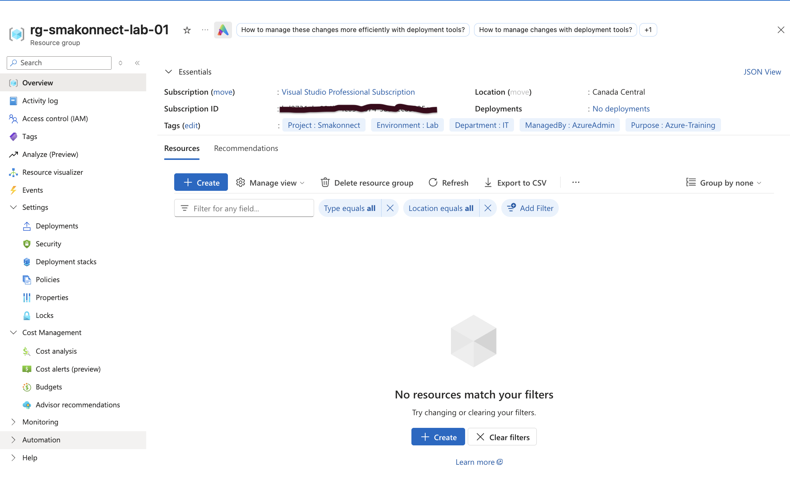
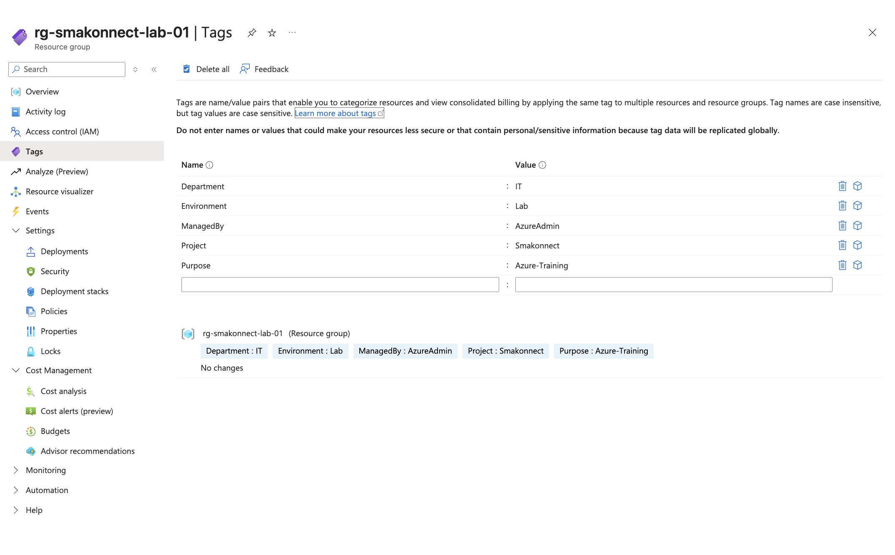
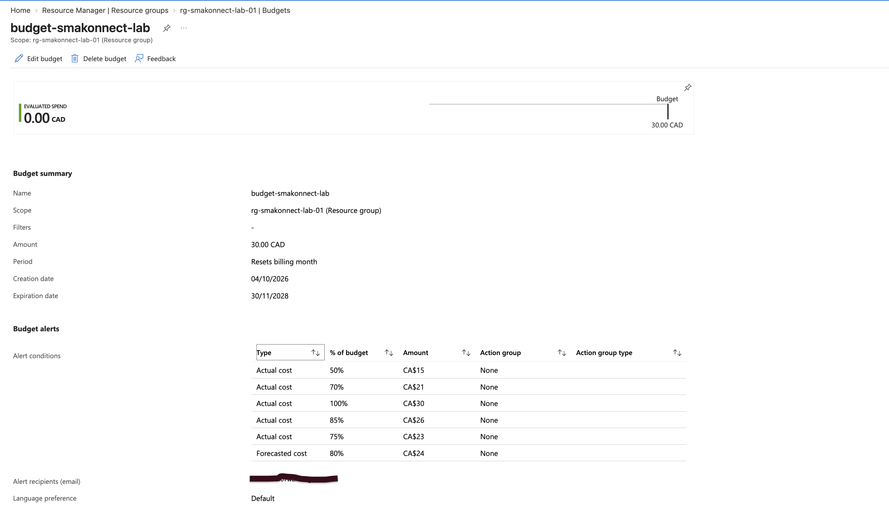
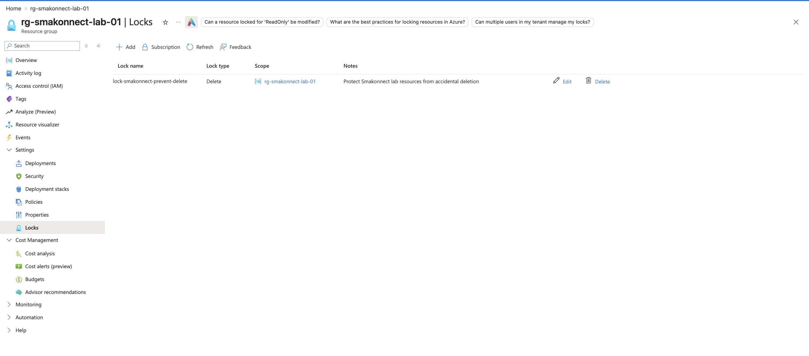
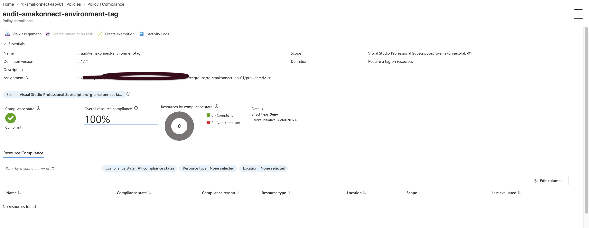

# Phase 2 — Azure Governance and Resource Organization

## Overview

In this phase, I configured governance controls for the Smakonnect Tech Innovation Azure lab environment. My goal was to organize the environment, establish resource management standards, monitor spending, and introduce safeguards against accidental deletion and inconsistent resource configurations.

This phase helped me understand how Azure administrators use governance tools to maintain control over cloud infrastructure.

## 1. Resource Group Configuration

I created a resource group named `rg-smakonnect-lab-01` in the Canada Central region.

The resource group serves as the main organizational container for the Azure resources I will deploy throughout the project.

## 2. Resource Tagging

I applied the following tags to the resource group to improve resource identification and management.

| Tag | Value |
|---|---|
| Project | Smakonnect |
| Environment | Lab |
| Department | IT |
| ManagedBy | AzureAdmin |
| Purpose | Azure-Training |

This exercise showed me how consistent tagging helps administrators identify resource ownership, purpose, and environment.

## 3. Azure Cost Management

I configured a monthly Azure budget of 30 in the subscription's billing currency, with alert thresholds at 50%, 80%, and 100%.

I learned that Azure budgets provide spending visibility and notifications but do not automatically stop resource charges when a threshold is reached.

## 4. Resource Protection

I created a Delete lock named `lock-smakonnect-prevent-delete` on the resource group.

The purpose of this lock is to reduce the risk of accidental resource deletion. I also learned that resource locks can affect cleanup operations and must be managed carefully when changes are required.

## 5. Azure Policy Configuration

I assigned the built-in Azure Policy definition `Require a tag on resources` to the Smakonnect resource group.

The assignment was configured as follows:

- **Assignment name:** `audit-smakonnect-environment-tag`
- **Scope:** `rg-smakonnect-lab-01`
- **Tag parameter:** `Environment`
- **Enforcement mode:** `DoNotEnforce`

The underlying policy uses a Deny effect, but I disabled enforcement for this exercise so that the assignment could be evaluated without blocking resource operations.

When I reviewed the Compliance dashboard, the assignment showed `Not started`, with no resources evaluated. I understood that this was not evidence of successful resource compliance.

## 6. Verification

After configuring the governance controls, I returned to the Azure Portal and verified the resource group, five tags, monthly budget and alerts, Delete lock, and policy assignment settings.

## Key Takeaways

This phase gave me practical experience with Azure resource organization, tagging, cost management, resource locks, and policy assignments.

I learned that Azure governance is not only about creating rules. It is also about controlling costs, protecting resources, verifying configurations, and maintaining consistent administrative standards.

## Phase Status

**Completed — Azure Governance and Resource Organization**

## Configuration Evidence

The following screenshots show the Azure governance configurations I completed and verified during this phase.

### 1. Resource Group

### 2. Resource Tags

### 3. Budget and Cost Alerts

### 4. Resource Lock

### 5. Azure Policy Assignment

The Azure Policy assignment was configured with enforcement disabled (`DoNotEnforce`). When I initially checked the Compliance dashboard, the evaluation had not started, so no resource compliance results were available yet.
