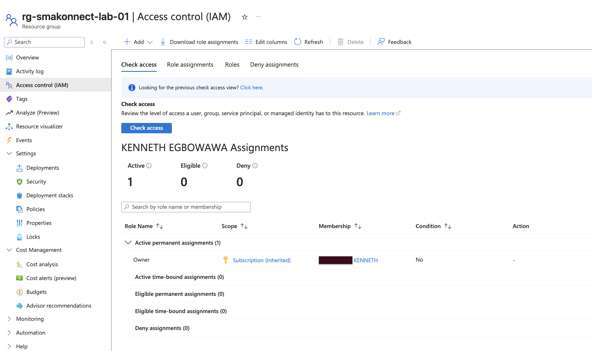
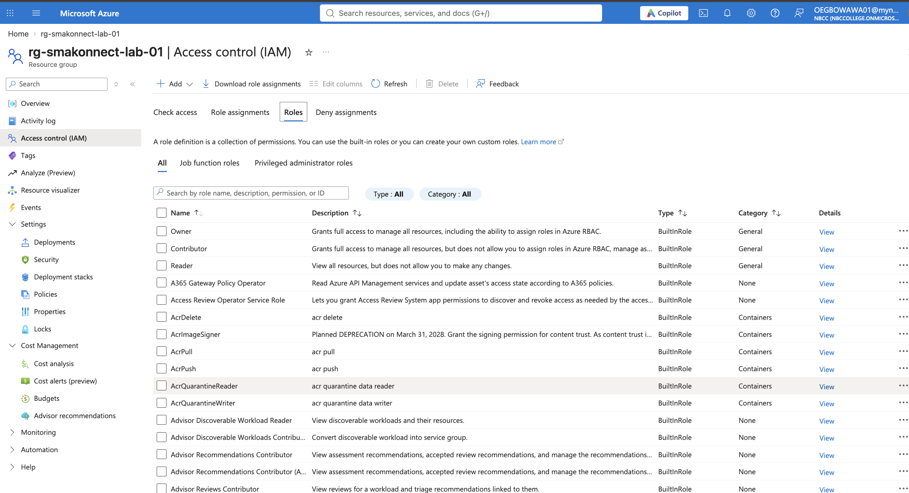
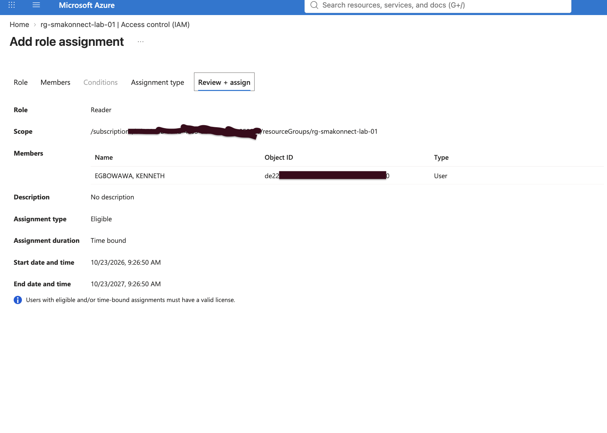

# Phase 3 — Azure RBAC and Access Management

## Overview

In this phase, I explored how Azure administrators manage access to cloud resources using Azure Role-Based Access Control (RBAC).

My goal was to understand how permissions are assigned, how access is inherited, and how to investigate access-related problems.

Because my Azure subscription is connected to a school-managed Microsoft Entra tenant, I focused on the Azure RBAC features available to me without making unauthorized directory changes.

## 1. Verifying My Azure RBAC Access

I opened the Smakonnect resource group, `rg-smakonnect-lab-01`, and navigated to **Access control (IAM) → View my access**.

I confirmed that my account has the **Owner** role, inherited from the subscription.

This showed me how Azure RBAC permissions assigned at a higher scope can apply to resources beneath that scope.

I also learned that having Owner access to an Azure subscription does not automatically provide administrator permissions in Microsoft Entra ID.

## 2. Exploring Built-in Azure Roles

I reviewed three commonly used Azure RBAC roles:

| Role | Main Permissions |
|---|---|
| Owner | Manages Azure resources and Azure RBAC access |
| Contributor | Manages Azure resources but cannot normally assign Azure RBAC roles |
| Reader | Views Azure resources without modifying them |

This helped me understand the principle of least privilege: giving users only the permissions needed to perform their responsibilities.

## 3. Reviewing the Role Assignment Process

I opened the **Add role assignment** wizard from the Smakonnect resource group's Access control (IAM) page.

I selected the built-in **Reader** role and examined the **Members** tab to understand how an administrator selects the identity receiving access.

I then exited the wizard without creating an assignment.

This exercise helped me understand the three parts of an Azure RBAC role assignment:

- **Security principal:** Who receives access.
- **Role definition:** What permissions are granted.
- **Scope:** Where those permissions apply.

I also reviewed the difference between Active and Eligible role assignments. Active assignments make permissions available immediately, while Eligible assignments require activation before the permissions can be used.

No new role assignments were created during this exercise.

## 4. Investigating Access and Troubleshooting

I reviewed the **Role assignments** and **Activity log** sections of the Smakonnect resource group.

Using a simulated IT support scenario, I investigated why a user with Reader access might be able to view a virtual machine but not restart it.

I learned that troubleshooting an authorization problem involves checking effective permissions, assignment scope, inherited roles, and other restrictions that may affect an operation.

I also explored the Azure Activity Log as a source of information about management operations and their results.

## 5. Microsoft Entra ID Access Limitation

I attempted to open Microsoft Entra ID in the Azure Portal but encountered an access error.

My school manages the Microsoft Entra tenant, so I did not attempt to modify directory settings or bypass the restriction.

Instead, I continued with the Azure RBAC exercises available through my subscription and resource group.

This reinforced the difference between managing Azure resources and administering an organization's identity directory.

## 6. Verification and Results

By the end of this phase, I had:

- Verified my inherited Owner role at subscription scope.
- Reviewed the permissions of Owner, Contributor, and Reader.
- Examined the Reader role assignment process without granting access.
- Learned the difference between Active and Eligible assignments.
- Reviewed role assignments and Azure Activity Logs.
- Identified and documented the limitation of my school-managed Entra tenant.

## Key Takeaways

This phase helped me understand how Azure administrators control access using roles and scopes.

I learned that permissions should be assigned according to job responsibilities, that inherited access must be considered during troubleshooting, and that Azure resource administration is different from Microsoft Entra tenant administration.

Although I did not create new user accounts or role assignments, I gained practical experience reviewing access configurations and investigating authorization scenarios.

## Screenshot Evidence

The following screenshots document my Azure RBAC access review and troubleshooting exercises.

### 1. Owner Role and Inherited Access

### 2. Built-in Azure RBAC Roles

### 3. Reader Role Assignment Wizard

## Phase Status

**Completed — Azure RBAC and Access Management**

**Next Phase:** Azure Virtual Networking and Connectivity.
