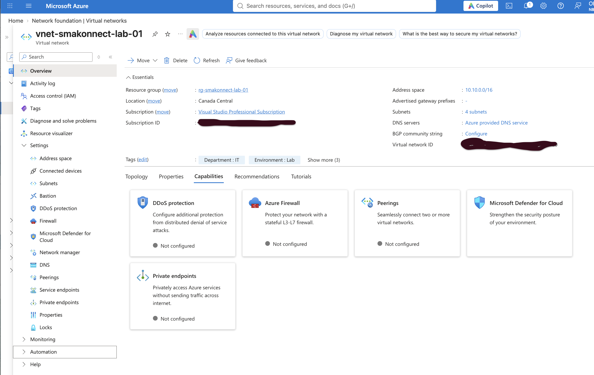
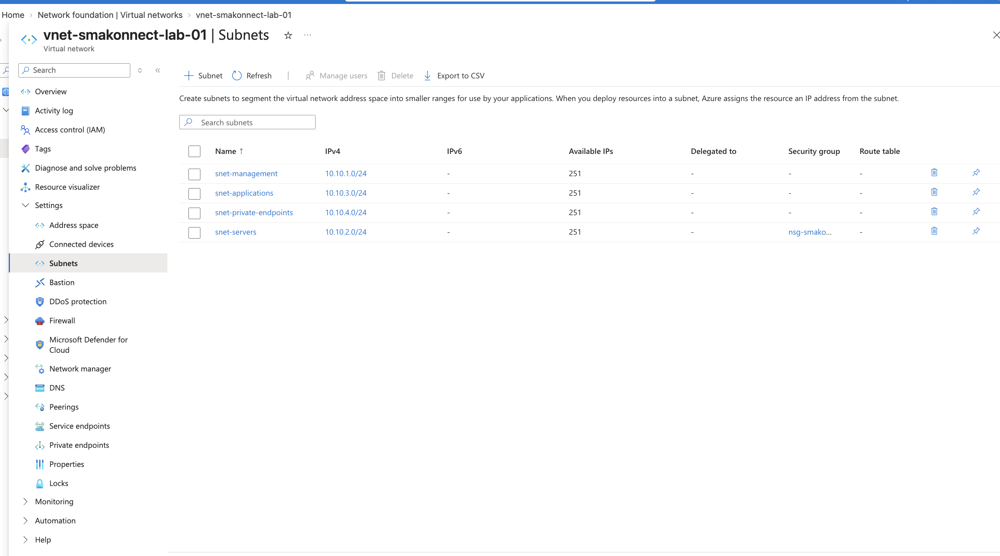
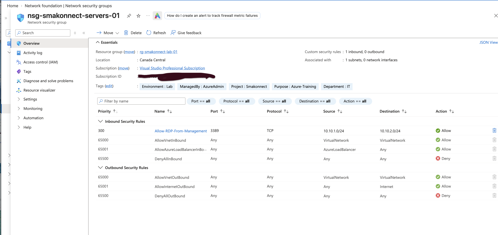
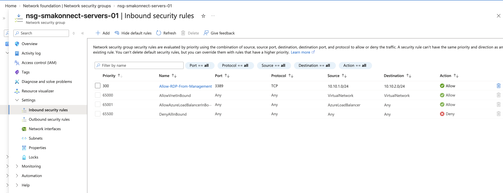
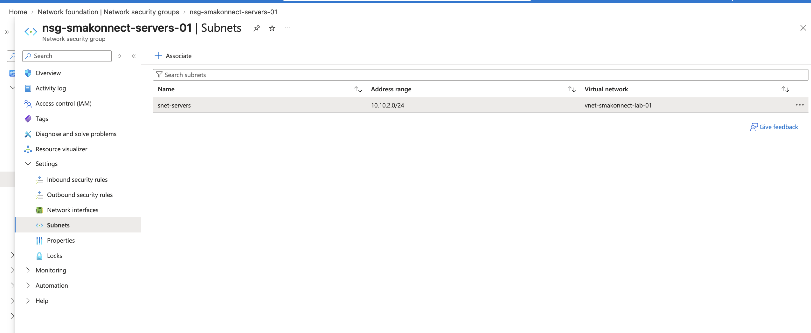

# Phase 4: Azure Virtual Networking and Connectivity

## Smakonnect Tech Innovation — Azure Infrastructure Project

**Project:** Smakonnect Azure Infrastructure (AZ-104 Hands-On Project)  
**Phase:** 4 — Azure Virtual Networking and Connectivity  
**Status:** Completed  
**Region:** Canada Central  
**Resource Group:** `rg-smakonnect-lab-01`

---

## 1. Introduction

In this phase, I worked on setting up the network infrastructure for Smakonnect Tech Innovation in Microsoft Azure.

The goal was to create a virtual network where the company's future servers, management systems, and applications could communicate using private IP addresses.

I also wanted to understand how Azure controls network traffic, especially how Network Security Groups (NSGs) work and where they should be associated.

Instead of just creating the resources, I spent time reviewing the settings and understanding why they are important in a real IT environment.

By the end of this phase, I had created a virtual network with four subnets, configured an NSG for the Servers subnet, and verified the networking configuration.

## 2. Creating the Azure Virtual Network

I started by creating a virtual network called:

`vnet-smakonnect-lab-01`

I deployed it in the **Canada Central** region under my existing resource group:

`rg-smakonnect-lab-01`

For the virtual network address space, I used:

`10.10.0.0/16`

I chose this private IP address range because it provides enough space to create multiple subnets as the environment grows.

### Virtual Network Overview

## 3. Configuring the Subnets

After creating the virtual network, I divided it into four subnets.

| Subnet Name | IP Address Range | Purpose |
|---|---|---|
| `snet-management` | `10.10.1.0/24` | For future management and administration systems |
| `snet-servers` | `10.10.2.0/24` | For Windows Server and Linux virtual machines |
| `snet-applications` | `10.10.3.0/24` | For future application workloads |
| `snet-private-endpoints` | `10.10.4.0/24` | For future private access to supported Azure services |

I created separate subnets because I wanted the network to be organized based on the purpose of each workload.

For example, the Servers subnet will be used for the virtual machines I plan to deploy in the next phase, while the Management subnet will be used for administrative systems.

One important thing I learned is that **creating separate subnets does not automatically block communication between them**. Azure allows communication within a virtual network by default, unless security rules or other network controls restrict it.

### Virtual Network Subnets

## 4. Creating a Network Security Group

After setting up the virtual network, I moved on to network security.

I created a Network Security Group named:

`nsg-smakonnect-servers-01`

The purpose of this NSG is to control network traffic for resources that will be deployed in the Servers subnet.

Before creating any custom rules, I reviewed the default inbound and outbound security rules.

This helped me understand that:

- **Inbound traffic** is traffic coming into a resource or subnet.
- **Outbound traffic** is traffic leaving a resource or subnet.
- **AllowVnetInBound** is a default rule that allows traffic from addresses included in Azure's VirtualNetwork service tag.
- **DenyAllInBound** blocks other incoming traffic that has not matched an earlier Allow rule.
- NSG rules are processed based on priority, with lower numbers evaluated first.

### Network Security Group Overview

## 5. Configuring an Inbound RDP Security Rule

Next, I created a custom inbound security rule called:

`Allow-RDP-From-Management`

I configured the rule with the following settings:

| Setting | Value |
|---|---|
| Rule Name | `Allow-RDP-From-Management` |
| Priority | 300 |
| Direction | Inbound |
| Source | `10.10.1.0/24` |
| Destination | `10.10.2.0/24` |
| Protocol | TCP |
| Destination Port | 3389 |
| Action | Allow |

The purpose of this rule is to explicitly allow Remote Desktop Protocol (RDP) connections from the Management subnet to the Servers subnet.

I used port **3389** because it is the standard port used by Windows Remote Desktop.

This was a useful exercise because it helped me understand how an NSG rule identifies traffic using the source address, destination address, protocol, and port.

I also learned that creating this Allow rule does not mean only Management can access RDP. Azure's default VNet Allow rule may still permit traffic from other internal subnets.

To enforce stricter access, I would need to configure additional security rules carefully.

### Inbound Security Rule

## 6. Associating the NSG with the Servers Subnet

One of the most important things I learned in this phase was how to decide where to associate an NSG.

At first, I was unsure whether an NSG should always be associated with the source subnet or the destination subnet.

After working through different examples, I understood that the decision depends on **which resources I want to protect or control**.

In this project, my goal was to control traffic to the company's future servers.

Since those servers will be deployed in `snet-servers`, I associated the NSG with that subnet.

This means the NSG will evaluate inbound and outbound traffic for resources in the Servers subnet.

I also learned that an NSG can be associated with a network interface when more specific VM-level security is required.

### NSG Subnet Association

## 7. Understanding NSG Rule Priorities

Another important part of this phase was learning how Azure evaluates security rules.

I learned that a rule with priority **200** is evaluated before a rule with priority **300**.

For example, if two rules match the same traffic and the priority 200 rule denies it, Azure will deny the connection even if the priority 300 rule allows it.

This helped me understand why checking rule priorities is important when troubleshooting network connectivity.

I also learned that NSGs are **stateful**, meaning that return traffic for an allowed connection does not need a separate rule.

## 8. Verifying the Network Configuration

After completing the configuration, I returned to the Azure Portal to review the resources.

I verified that:

- The virtual network address space was `10.10.0.0/16`.
- All four subnets had the correct IP address ranges.
- The Servers subnet was associated with `nsg-smakonnect-servers-01`.
- The custom RDP rule had the correct source, destination, protocol, port, and priority.
- The default outbound security rules were present.

I also learned about Azure Network Watcher and how tools such as IP flow verify, effective security rules, and connection troubleshooting can help investigate networking issues.

I did not perform live connectivity testing because I have not deployed any virtual machines yet.

That will be part of the next phase.

## 9. Challenges and What I Learned

One challenge I had was understanding the difference between an NSG association and the source and destination settings inside an NSG rule.

At first, I thought an NSG might always need to be associated with the destination subnet.

I now understand that an NSG should be associated with the subnet or network interface whose traffic I want to control.

For example:

- To control incoming connections to servers, I can associate an NSG with the Servers subnet and configure inbound rules.
- To control connections leaving management systems, I can associate an NSG with the Management subnet and configure outbound rules.
- In a larger environment, I may need NSGs on both sides of a connection.

I also gained a better understanding of private IP addressing, subnet planning, RDP, default NSG rules, and rule priorities.

These are important skills for troubleshooting Azure networking problems in a real IT support or systems administration role.

## 10. Cost Management

Since this project is running on my Azure student learning environment, I made sure not to deploy unnecessary resources.

I created the virtual network, subnets, and NSG without deploying virtual machines, NAT gateways, or Azure Firewall.

I will continue monitoring Azure costs as I move into the next phase.

## 11. Conclusion

In Phase 4, I successfully built the foundation of Smakonnect Tech Innovation's Azure network.

I created a virtual network, organized it into four subnets, configured a Network Security Group, added a custom RDP rule, and verified the configuration.

More importantly, I now have a better understanding of how Azure network security works and how to decide where an NSG should be associated.

The network is ready for the next stage of the project, where I will deploy and manage Windows Server and Linux virtual machines.

**Phase 4 Status: Completed**

**Next Phase: Phase 5 — Windows Server and Linux Virtual Machine Administration**
