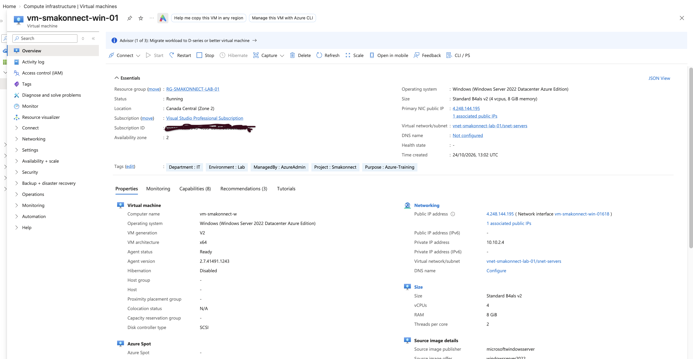
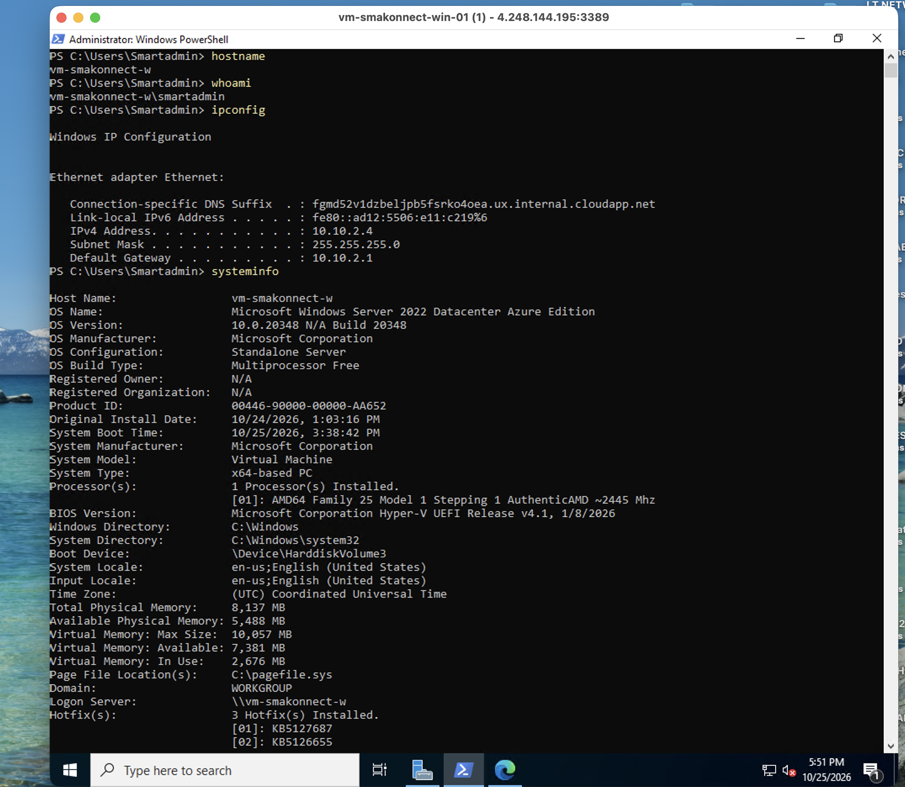
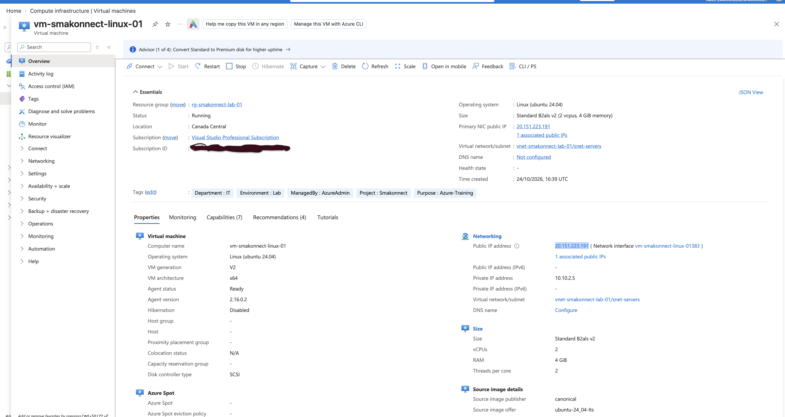
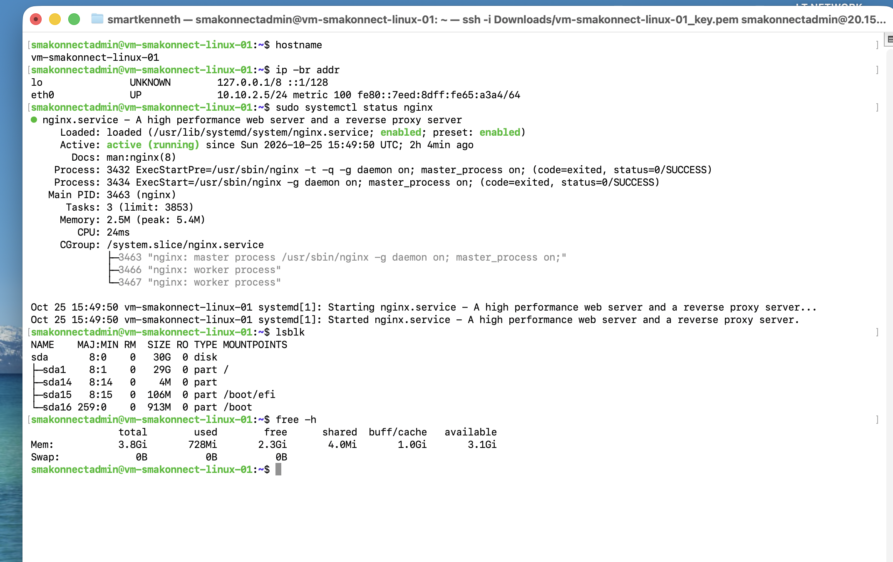
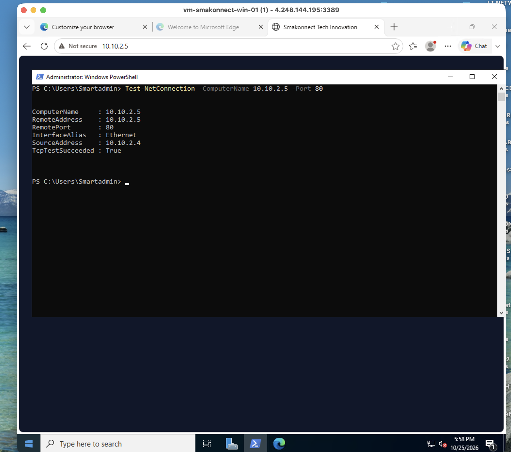
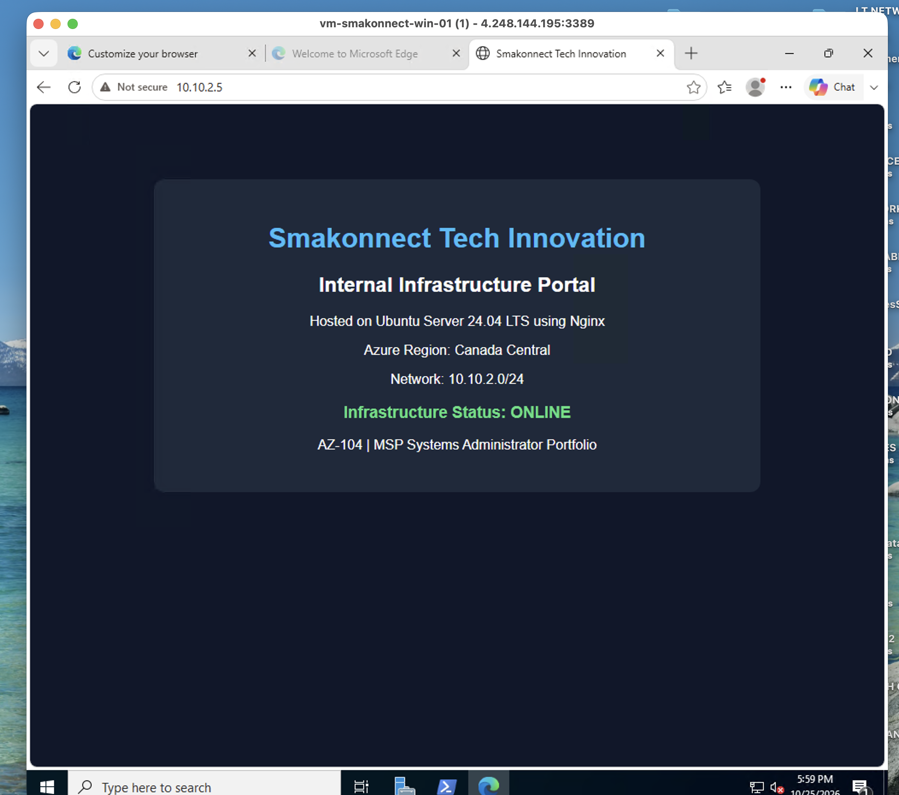
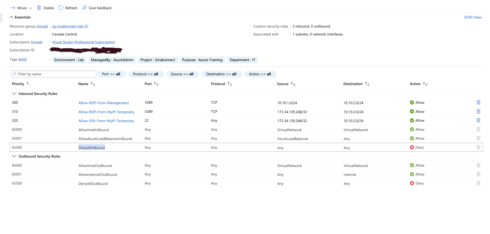
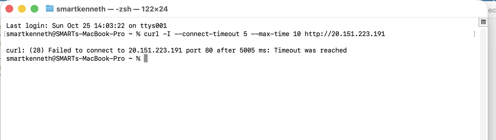

# Phase 05 — Deploying and Managing Windows & Linux Virtual Machines in Azure

**Project:** Smakonnect Tech Innovation — Azure Infrastructure Lab  
**Role:** Azure Administrator / Systems Administrator (Hands-on Lab)  
**Azure Region:** Canada Central  
**Resource Group:** `rg-smakonnect-lab-01`  
**Status:** Completed

## Overview

In this phase of my Azure infrastructure project, I deployed and configured two virtual machines: one running Windows Server 2022 and the other running Ubuntu Server 24.04 LTS.

My goal was to go beyond simply creating virtual machines in the Azure portal. I wanted to understand how Windows and Linux servers are administered, how they communicate inside an Azure virtual network, and how network security rules affect access to services.

To make the environment more realistic, I installed Nginx on the Ubuntu server and hosted a simple internal website for Smakonnect Tech Innovation. I then used the Windows server to access that website through Azure's private network.

I also encountered and troubleshot a connectivity issue between the two servers, which became one of the most useful parts of this phase.

## 1. What I Built

Both virtual machines were deployed in the existing Smakonnect Azure environment created during the earlier networking phase.

| Resource | Configuration |
|---|---|
| Resource group | `rg-smakonnect-lab-01` |
| Virtual network | `vnet-smakonnect-lab-01` |
| VNet address space | `10.10.0.0/16` |
| Subnet | `snet-servers` |
| Subnet address range | `10.10.2.0/24` |
| Network security group | `nsg-smakonnect-servers-01` |
| Windows VM | `vm-smakonnect-win-01` |
| Windows private IP | `10.10.2.4` |
| Ubuntu VM | `vm-smakonnect-linux-01` |
| Ubuntu private IP | `10.10.2.5` |

The Windows server was used for administration and connectivity testing. The Ubuntu server was used for Linux administration and internal web hosting.

Both machines communicate through private IP addresses within the same Azure subnet.

## 2. Deploying Windows Server 2022

I deployed `vm-smakonnect-win-01` using Windows Server 2022 Datacenter: Azure Edition.

### VM Configuration

| Setting | Value |
|---|---|
| VM size | `Standard_B4als_v2` |
| Operating system | Windows Server 2022 |
| OS disk | Standard SSD (LRS) |
| Security type | Trusted Launch |
| Virtual network | `vnet-smakonnect-lab-01` |
| Subnet | `snet-servers` |
| Private IP | `10.10.2.4` |
| Remote administration | RDP |

I selected a burstable VM size for the lab to balance performance and cost. I also used Standard SSD storage rather than more expensive premium storage because this environment does not require production-level disk performance.

### Windows Administration

After deployment, I connected to the VM using Remote Desktop from my Mac.

I explored Server Manager, Task Manager, Windows services, Event Viewer, and Windows Defender Firewall.

I also used PowerShell and Command Prompt to inspect the server:

```powershell
hostname
ipconfig
systeminfo
```

These activities helped me understand the difference between deploying a VM in Azure and actually managing the operating system running inside it.

**What I learned:** Azure provides the underlying compute infrastructure, but the administrator is still responsible for the guest operating system, services, updates, configuration, and security.





## 3. Deploying Ubuntu Server 24.04 LTS

Next, I deployed `vm-smakonnect-linux-01` in the same subnet as the Windows server.

### VM Configuration

| Setting | Value |
|---|---|
| VM size | `Standard_B2als_v2` |
| Operating system | Ubuntu Server 24.04 LTS |
| OS disk | 30 GiB Standard SSD (LRS) |
| Security type | Trusted Launch |
| Virtual network | `vnet-smakonnect-lab-01` |
| Subnet | `snet-servers` |
| Private IP | `10.10.2.5` |
| Administrator username | `smakonnectadmin` |
| Remote administration | SSH with public-key authentication |

I used SSH key authentication rather than password-based SSH access.

From my Mac Terminal, I connected to Ubuntu and practiced Linux administration commands.

### Linux Administration

Some of the commands I used were:

```bash
whoami
hostname
cat /etc/os-release
ip -br addr
ip route
lscpu
free -h
df -h
lsblk
systemctl status ssh
systemctl --failed
```

I also explored running processes and system logs using `top` and `journalctl`.

These commands helped me check the server's identity, operating system, network configuration, hardware resources, storage, and service health.

**What I learned:** Many Linux administration tasks can be performed directly from the terminal without a graphical desktop. I also gained a better understanding of how SSH, Linux services, and system logs are used in day-to-day server management.





## 4. Troubleshooting Connectivity Between Windows and Ubuntu

This was one of the most valuable parts of the project because everything did not work perfectly on the first attempt.

### The Problem

I was testing connectivity between the two VMs and noticed that Windows could ping Ubuntu, but Ubuntu could not ping Windows.

Initially, I wasn't sure whether the issue was caused by Azure networking, the Network Security Group, or the operating system firewall.

Instead of changing several settings at once, I tested different parts of the connection.

### My Troubleshooting Process

**Step 1 — Checked Ubuntu's network configuration**

I ran:

```bash
ip route
```

The output showed that Ubuntu had the expected private IP address, `10.10.2.5`, and a default route through `10.10.2.1`.

**Step 2 — Tested a different protocol**

From Windows PowerShell, I checked whether Ubuntu's SSH port was reachable:

```powershell
Test-NetConnection -ComputerName 10.10.2.5 -Port 22
```

The result showed:

```text
TcpTestSucceeded : True
```

This confirmed that Windows could establish a TCP connection to Ubuntu.

**Step 3 — Checked outbound internet connectivity**

On Ubuntu, I ran:

```bash
curl -I --connect-timeout 5 --max-time 10 https://www.microsoft.com
```

The command returned an HTTP 200 response.

This showed that Ubuntu could resolve a public hostname and connect to an external HTTPS service.

**Step 4 — Investigated Windows Firewall**

I created a temporary Windows Defender Firewall rule allowing ICMPv4 echo requests from Ubuntu's private IP address.

After applying the rule, Ubuntu was able to ping Windows at `10.10.2.4`.

I then removed the temporary diagnostic rule.

### Root Cause

The successful test after the firewall change confirmed that Windows Firewall was preventing the original inbound ping requests.

I also learned that Azure's virtual gateway address, `10.10.2.1`, does not need to respond to ping for routing to work.

### What I Learned

A failed ping does not automatically mean that a server is offline or that the network is broken.

Different protocols can behave differently depending on firewall rules. Testing TCP connectivity, reviewing routes, checking services, and examining firewall settings provides a much clearer picture of where a problem exists.

This exercise improved my confidence in troubleshooting connectivity issues systematically.

## 5. Hosting an Internal Website with Nginx

After confirming connectivity between the servers, I wanted to give the Ubuntu VM a practical purpose.

I installed Nginx to host a simple internal website for Smakonnect Tech Innovation.

### Installing Nginx

On Ubuntu, I ran:

```bash
sudo apt update
sudo apt install nginx -y
```

I verified that the service was running:

```bash
sudo systemctl status nginx
```

I also tested the local web server:

```bash
curl -I http://localhost
```

The server returned an HTTP 200 response.

### Creating the Website

I created a custom HTML page in Nginx's default web directory:

```text
/var/www/html/index.html
```

The page displayed a Smakonnect Tech Innovation internal infrastructure portal.

This was a static HTML/CSS website, rather than a database-backed application. Its purpose was to demonstrate basic web hosting and private server-to-server connectivity.

### Accessing the Website from Windows

From Windows PowerShell, I tested whether Ubuntu was reachable on HTTP port 80:

```powershell
Test-NetConnection -ComputerName 10.10.2.5 -Port 80
```

The connection succeeded.

I then opened Microsoft Edge inside the Windows VM and visited:

```text
http://10.10.2.5
```

The Smakonnect website loaded successfully.

This confirmed that the Windows VM could access a service hosted on Ubuntu through the private Azure network.





### What I Learned

This exercise helped me understand the basic relationship between a web client and a web server.

Windows acted as the client requesting the page, while Nginx on Ubuntu received the HTTP request and returned the website files.

It also demonstrated that a website can be hosted internally without needing to make it publicly accessible.

## 6. Validating Network Security

I reviewed the inbound security rules for `nsg-smakonnect-servers-01`, which is associated with the Servers subnet.

### Relevant NSG Rules

| Rule | Priority | Purpose |
|---|---|---|
| `Allow-RDP-From-Management` | 300 | Allow RDP from the Management subnet |
| `Allow-RDP-From-MyIP-Temporary` | 310 | Temporary RDP access from a restricted public IP |
| `Allow-SSH-From-MyIP-Temporary` | 320 | Temporary SSH access from a restricted public IP |
| `AllowVnetInBound` | 65000 | Allow traffic within the virtual network |
| `DenyAllInBound` | 65500 | Deny unmatched inbound traffic |

I confirmed that there was no custom inbound rule allowing public HTTP access on port 80.

### Testing Internal and External Access

I performed two tests:

**Internal test:** The Windows VM successfully accessed the website using Ubuntu's private IP address, `10.10.2.5`.

**External test:** From my Mac, I attempted to connect to Ubuntu's public IP address on port 80. The request timed out.

The external timeout was consistent with the NSG's default deny behavior.

Together, these tests demonstrated the intended configuration: the website was reachable internally, while public HTTP access was not permitted by the NSG rules.





### Security Improvements Identified

Although the lab met its immediate objectives, I identified areas that would need attention in a production environment:

- Remove temporary public RDP and SSH rules when no longer required.
- Restrict administrative rules to specific destination VMs where possible.
- Use TCP explicitly for SSH rules.
- Consider Azure Bastion or VPN-based administration instead of direct public access.
- Use HTTPS and appropriate authentication for real internal applications.
- Apply more restrictive subnet and application-level access controls where required.

These are future improvements, not controls I am claiming to have implemented during this phase.

## 7. Cost Management

Because this project uses a limited Azure lab budget, I considered cost when selecting and operating the virtual machines.

I used burstable VM sizes and Standard SSD disks rather than deploying more expensive resources.

I also configured automatic shutdown and planned to stop and deallocate the VMs when they were not needed.

I learned that stopping a VM from inside the operating system is not necessarily the same as deallocating it through Azure. Compute charges stop when the VM is deallocated, although storage and some networking charges can continue.

## 8. Skills Practiced

During this phase, I gained hands-on experience with:

- Deploying Windows and Linux virtual machines in Azure.
- Managing Windows Server through RDP.
- Managing Ubuntu through SSH and Linux commands.
- Reviewing VM networking and operating system configuration.
- Troubleshooting ICMP and TCP connectivity.
- Working with Windows Defender Firewall and Azure NSGs.
- Installing and managing Nginx.
- Hosting and testing an internal website.
- Validating private and public network access.
- Considering infrastructure security and Azure costs.

## 9. Final Reflection

Before this phase, I understood that Azure could host virtual machines, but I had limited practical experience with how those machines communicate and how their operating systems are managed.

The most important part of this lab was troubleshooting the failed Ubuntu-to-Windows ping. It forced me to investigate the problem instead of assuming the Azure network was incorrectly configured.

Hosting the Nginx website was another important milestone. Seeing the page load from Windows helped me connect several concepts: virtual machines, private IP addressing, TCP ports, operating system services, and Network Security Groups.

By the end of the phase, I had a working two-server Azure environment and a better understanding of the responsibilities involved in administering cloud infrastructure.

**Phase 05 Status: Completed**

**Next: Phase 06 — Azure Storage and Data Management**
