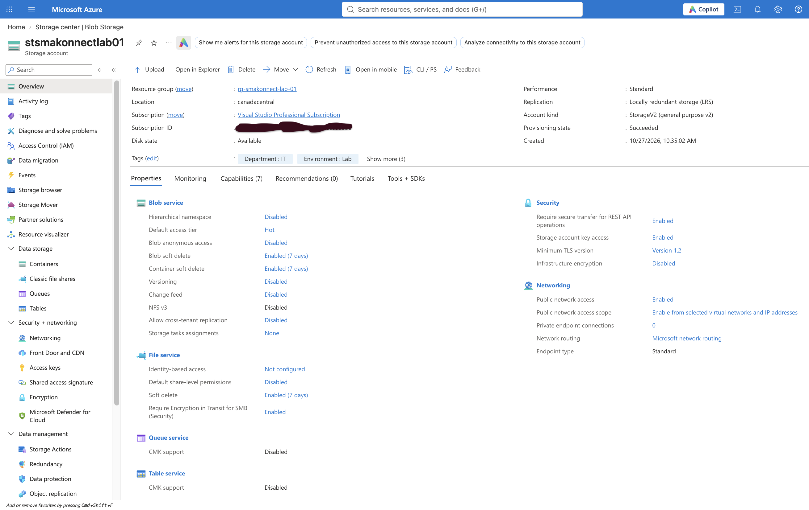
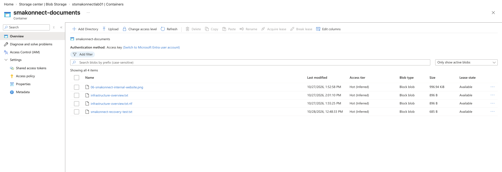
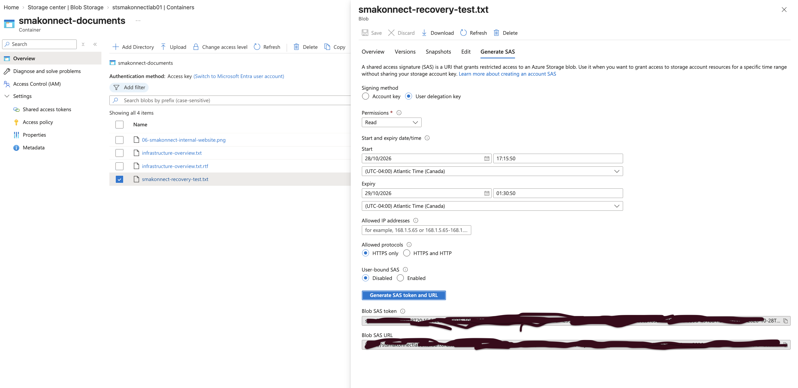
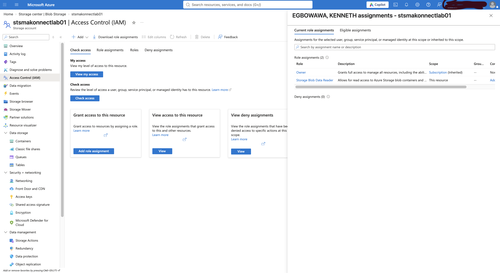
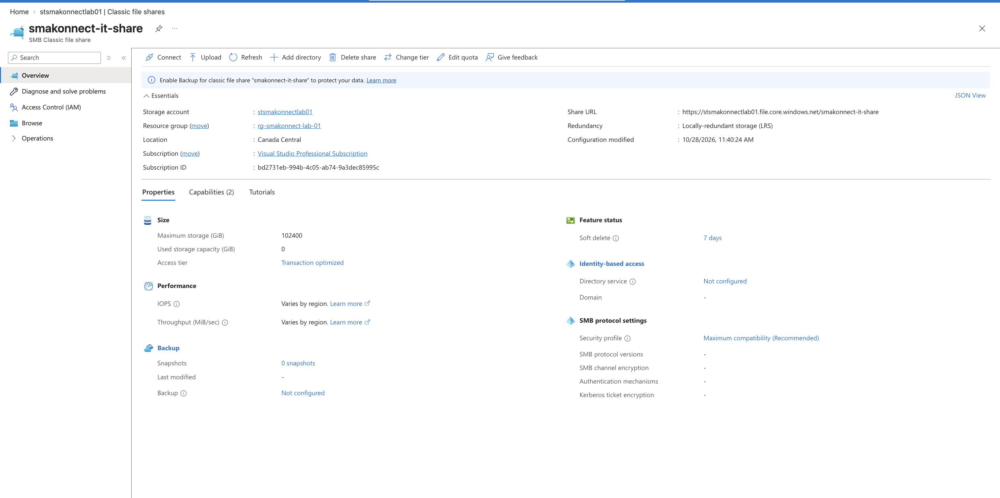
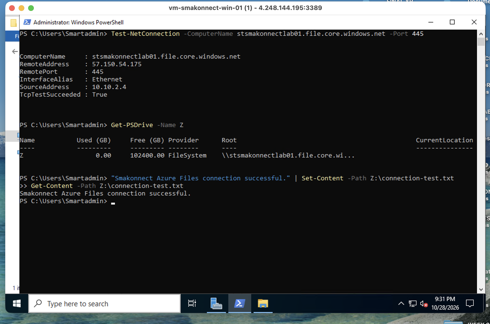
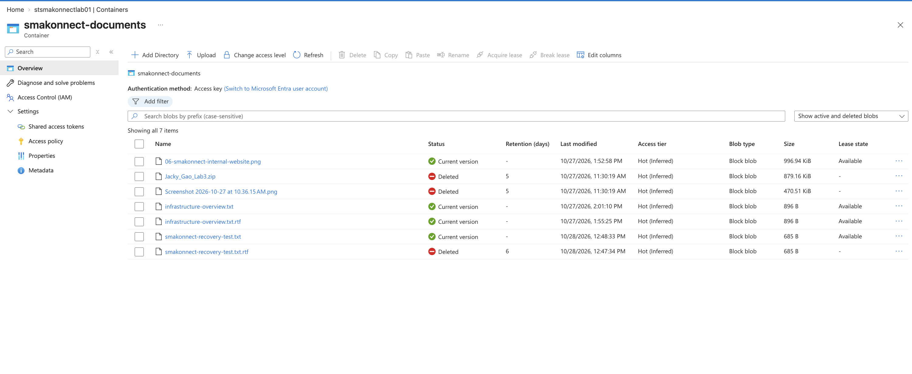
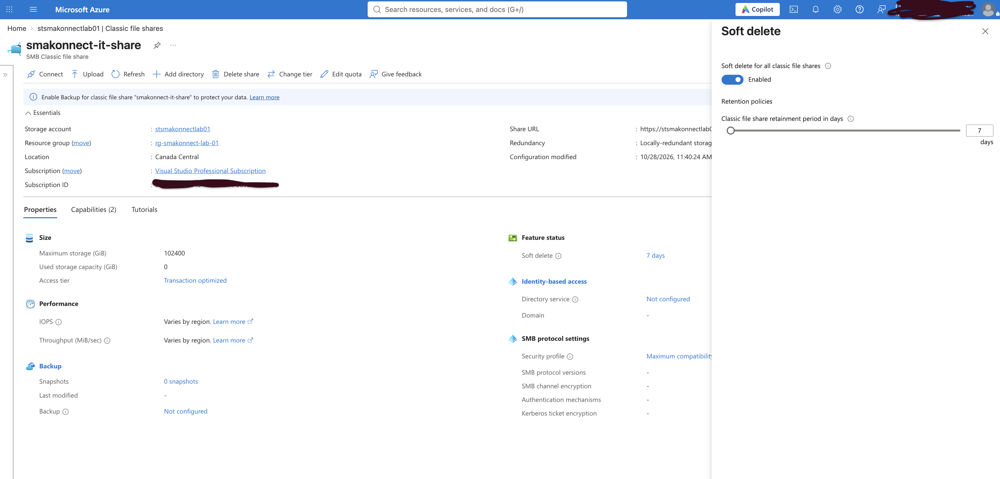
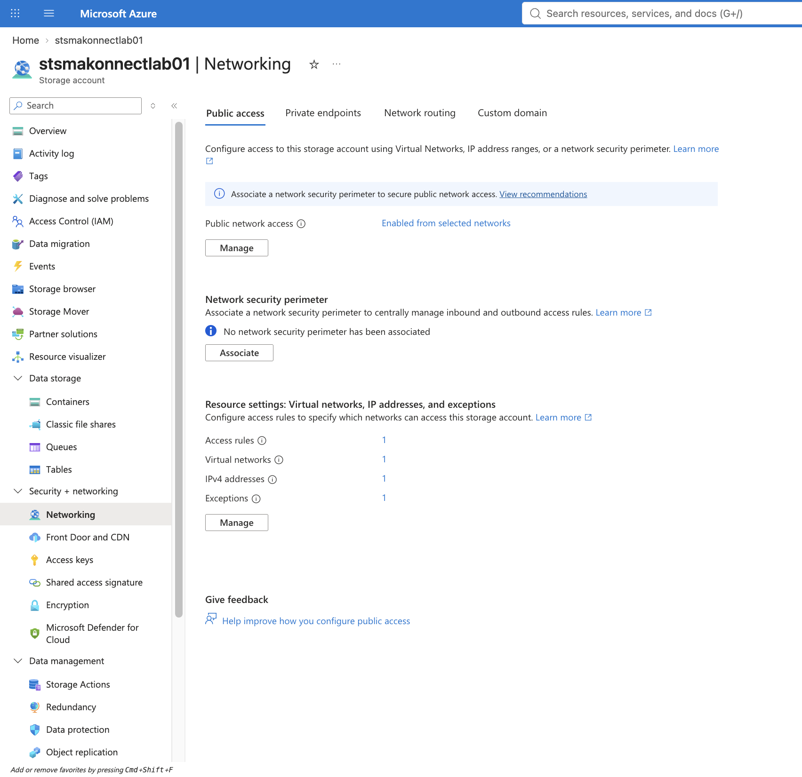

# Phase 06 — Azure Storage Administration and Data Protection

**Project:** Smakonnect Tech Innovation — Azure Infrastructure Administration  
**Environment:** Microsoft Azure Lab  
**Region:** Canada Central  
**Resource Group:** `rg-smakonnect-lab-01`  
**Status:** Completed

## Overview

In this phase, I extended the Smakonnect Azure environment with centralized storage services for documents, shared files, and operational data.

The objective was to configure and administer Azure Storage beyond the initial resource deployment. I worked with Blob Storage, Azure Files, access control, network restrictions, and data recovery, then validated the configuration through practical tests.

I also investigated an authorization failure involving a User Delegation SAS and resolved it by reviewing the difference between Azure resource management permissions and storage data permissions.

The completed work demonstrates storage provisioning, access management, Windows Server integration, security configuration, and troubleshooting within an existing Azure infrastructure environment.

---

## 1. Storage Architecture

I deployed a general-purpose v2 storage account within the existing Smakonnect resource group.

### Storage Account Configuration

| Setting | Configuration |
|---|---|
| Storage account | `stsmakonnectlab01` |
| Resource group | `rg-smakonnect-lab-01` |
| Region | Canada Central |
| Account kind | StorageV2 |
| Performance | Standard |
| Redundancy | Locally-redundant storage (LRS) |
| Default Blob access tier | Hot |
| Secure transfer required | Enabled |
| Minimum TLS version | 1.2 |
| Anonymous Blob access | Disabled |
| Hierarchical namespace | Disabled |

I selected Standard storage because the project does not require premium storage performance.

The account was initially deployed with read-access geo-redundant storage (RA-GRS). After reviewing the replication configuration and cost implications, I changed it to LRS.

LRS maintains three copies of data within a single Azure datacenter in the primary region. It provides local redundancy at a lower cost than geo-redundant options, making it appropriate for this lab environment.

### Storage Services

I configured two storage services within the same StorageV2 account.

| Service | Resource | Purpose |
|---|---|---|
| Azure Blob Storage | `smakonnect-documents` | Store documents and test object-level access |
| Azure Files | `smakonnect-it-share` | Provide centralized file storage to Windows Server over SMB |

Using one general-purpose storage account allowed me to work with both object storage and traditional network file sharing without deploying separate storage accounts.



---

## 2. Blob Storage Deployment

I created a private Blob container named:

`smakonnect-documents`

The container was configured without anonymous public access.

I uploaded infrastructure documents and verified that the files could be retrieved through an authenticated Azure session.

The uploaded objects included a sample infrastructure overview and files used during subsequent access and recovery tests.

### Validation

I confirmed that:

- The container was created successfully.
- Uploaded blobs appeared in the container.
- Blob properties and metadata were available.
- Files could be downloaded and opened.
- Anonymous Blob access remained disabled at the storage account level.

This provided a working location for storing and retrieving objects independently of the Windows and Linux VM operating system disks.



---

## 3. User Delegation SAS and Access Control

I configured a Shared Access Signature (SAS) to test temporary, read-only access to a private blob.

The intended access configuration was:

| Setting | Configuration |
|---|---|
| SAS type | User Delegation SAS |
| Resource scope | Individual blob |
| Permission | Read |
| Protocol | HTTPS only |
| Validity | Short-lived |
| Anonymous container access | Disabled |

A SAS allows access to a specific storage resource without requiring the recipient to sign in to the Azure Portal.

However, the SAS URL is a bearer credential. Anyone possessing a valid URL may be able to use its permissions, subject to its restrictions and the storage account's network controls.

### Troubleshooting: SAS Generation and Authorization

The SAS exercise required troubleshooting two separate errors.

**Issue 1 — Invalid expiry value**

The initial attempt to generate a User Delegation SAS returned:

`InvalidXmlNodeValue`

The error referenced the expiry field.

I reviewed the start and expiry values and identified a likely timezone mismatch in the configured validity window.

I corrected the time settings using UTC and generated a new SAS.

**Issue 2 — AuthorizationPermissionMismatch**

After resolving the expiry issue, the generated SAS URL returned:

`AuthorizationPermissionMismatch`

The SAS requested read access, but the storage service rejected the download.

Rather than enabling public access or changing the SAS to broader permissions, I investigated the permissions assigned to the identity generating the User Delegation SAS.

### Root Cause Investigation

I opened the storage account's **Access Control (IAM)** section and reviewed my effective role assignments.

My account had the Owner role inherited from the subscription.

However, the Owner role primarily provides management-plane permissions. It does not automatically grant Microsoft Entra-based access to Blob contents.

A User Delegation SAS is constrained by both the SAS permissions and the data permissions of the identity that generates it.

The absence of an applicable Blob data role was consistent with the authorization failure.

### Resolution

I assigned the following role to my account:

| Setting | Value |
|---|---|
| Role | Storage Blob Data Reader |
| Scope | Storage account |
| Principal | My Azure account |
| Purpose | Read Blob data using Microsoft Entra authorization |

After allowing time for the assignment to propagate, I generated a fresh read-only User Delegation SAS.

The file then opened successfully through the SAS URL.

### Result

The issue was resolved without making the container public or granting unnecessary Blob write permissions.

This demonstrated the difference between:

- Azure management-plane permissions.
- Storage data-plane permissions.
- SAS-level permissions.
- Network-level access restrictions.

It also reinforced the importance of investigating the specific authorization layer responsible for an access failure.





**Security note:** SAS signatures, storage account keys, and other credentials are excluded from the repository and screenshots.

---

## 4. Blob Access Security

The Blob container remained private throughout the exercise.

I used a read-only User Delegation SAS to provide controlled access to an individual object.

The SAS was configured with HTTPS-only access and a limited validity period.

This approach avoids making the entire container anonymously accessible.

I also reviewed the relationship between SAS authorization and the storage firewall.

A valid SAS does not override storage account network restrictions. Requests must satisfy both the network access policy and the permissions granted by the SAS.

This became especially relevant when I restricted the storage account to selected networks later in the phase.

---

## 5. Azure Files Deployment

I created an Azure file share within the existing storage account.

### File Share Configuration

| Setting | Configuration |
|---|---|
| Storage account | `stsmakonnectlab01` |
| File share | `smakonnect-it-share` |
| Share type | Standard Azure Files |
| Access tier | Transaction optimized |
| Protocol | SMB |
| Share soft delete | Enabled — 7 days |

The file share provides centralized storage that can be accessed by supported clients over SMB.

Unlike Blob Storage, Azure Files can be mounted as a network drive in Windows, allowing applications and administrators to work with files using familiar file system operations.



---

## 6. Connecting Windows Server to Azure Files

I connected the existing Windows Server VM to the Azure file share.

### Windows Server Details

| Setting | Value |
|---|---|
| Virtual machine | `vm-smakonnect-win-01` |
| Operating system | Windows Server 2022 |
| Private IP | `10.10.2.4` |
| Virtual network | `vnet-smakonnect-lab-01` |
| Subnet | `snet-servers` |
| File share | `smakonnect-it-share` |
| Mapped drive | `Z:` |

### SMB Connectivity Test

Before mapping the share, I tested connectivity from Windows PowerShell:

```powershell
Test-NetConnection -ComputerName stsmakonnectlab01.file.core.windows.net -Port 445
```

The result was:

```text
TcpTestSucceeded : True
```

This confirmed that the Windows VM could establish a TCP connection to the Azure Files endpoint over port 445.

### Mapping the File Share

I used the Azure-generated Windows connection instructions to map the file share as drive `Z:`.

For this lab, the connection used storage account key authentication.

I verified that the mapped drive was available:

```powershell
Get-PSDrive Z
Test-Path Z:\
```

The path test returned:

```text
True
```

### Read and Write Validation

I created an IT operations directory on the mapped share:

```powershell
New-Item -Path "Z:\IT-Operations" -ItemType Directory
```

I then wrote a test file:

```powershell
"Smakonnect Azure Files connectivity verified." |
    Set-Content -Path "Z:\IT-Operations\connectivity-test.txt"
```

Finally, I read the file back:

```powershell
Get-Content "Z:\IT-Operations\connectivity-test.txt"
```

The returned content matched the text originally written.

This confirmed that Windows Server could access the Azure file share and perform file operations through SMB.

I also reviewed the file share in Azure Portal to verify the centralized storage location.



### Operational Considerations

Storage account key authentication was used for this controlled lab.

Because account keys provide broad access to storage resources, they require careful handling and should not be exposed in scripts, screenshots, or public repositories.

For a production environment, I would evaluate identity-based SMB authentication, appropriate share-level permissions, and access controls based on organizational requirements.

---

## 7. Windows VM Allocation Troubleshooting

While preparing the Windows Server for the Azure Files connectivity exercise, the VM failed to start.

Azure reported:

`ZonalAllocationFailed`

The error indicated insufficient compute capacity for the requested VM size in the selected availability zone.

### Investigation and Resolution

The Windows VM had previously been deployed using the `Standard_B4als_v2` size.

Because the VM had been deallocated, Azure needed to allocate compute capacity when it was started again.

The requested size was unavailable at that time.

I reviewed the startup failure and resized the VM to an alternative size.

After the resize, the VM started successfully.

I was able to reconnect to Windows Server and continue the Azure Files exercise without rebuilding the operating system.

The existing Windows environment and private network connectivity remained operational.

### Operational Lesson

Azure VM allocation failures can be caused by capacity constraints rather than guest operating system problems.

Resizing to a compatible VM size can provide a recovery path while retaining the existing managed OS disk and configuration.

This incident also reinforced the importance of validating application and network functionality after infrastructure changes.

---

## 8. Blob Soft Delete and Recovery Validation

I reviewed the storage account's data protection settings and confirmed that Blob soft delete and container soft delete were enabled with a seven-day retention period.

### Recovery Test

I performed a controlled recovery exercise using a disposable test blob.

The process involved:

1. Uploading a recovery test document to `smakonnect-documents`.
2. Deleting the test blob.
3. Enabling the option to display active and deleted blobs.
4. Locating the deleted object.
5. Restoring the blob using **Undelete**.
6. Downloading and verifying the recovered file.

The recovery completed successfully.

### Result

The test confirmed that a deleted blob could be recovered within the configured soft-delete retention period.

This demonstrated a practical recovery operation rather than simply confirming that the feature was enabled.



### Recovery Limitations

Blob soft delete is useful for accidental deletion recovery, but it is not a complete backup and disaster recovery strategy.

Additional capabilities such as versioning, backup, and point-in-time recovery should be evaluated according to recovery objectives and business requirements.

These additional features were not deployed during this lab.

---

## 9. Azure Files Data Protection

I also reviewed the protection settings for the Azure file share.

The `smakonnect-it-share` file share had a seven-day soft-delete retention period configured.

This protects against accidental deletion of the entire file share within the retention period.

It is important to distinguish share-level protection from file-level recovery.

**File share soft delete does not, by itself, restore individual files or folders deleted inside an active share.**

For file-level recovery, organizations can use Azure Files share snapshots or supported Azure Backup configurations.

I verified the existing share-level soft-delete setting without deleting the active file share.



---

## 10. Storage Network Security

After completing the storage connectivity and recovery exercises, I reviewed the storage account's network access configuration.

Initially, public network access was enabled from all networks.

Although the Blob container required authorization, the storage endpoints were reachable from any network.

I changed the storage account configuration to use selected networks.

### Network Access Configuration

| Setting | Configuration |
|---|---|
| Public network access | Enabled from selected networks |
| Approved virtual network | `vnet-smakonnect-lab-01` |
| Approved subnet | `snet-servers` |
| Approved client access | Restricted public IPv4 address |
| Azure Storage service endpoint | Used for subnet-based access |
| Anonymous Blob access | Disabled |

The configuration allows approved clients and Azure workloads to access the storage account while restricting requests from other networks.

The storage account continues to use public service endpoints, but access is filtered by the configured firewall rules.

### Security Design

This configuration combines two separate security controls.

**Network authorization:** Determines whether a request originates from an approved network.

**Data authorization:** Determines whether the requesting identity or credential has permission to access the storage resource.

For example, a valid SAS URL does not automatically allow access from an IP address blocked by the storage firewall.

This provides an additional layer of protection if a SAS URL is accidentally disclosed.



### Future Improvements

For a production deployment, I would consider:

- Private endpoints and private DNS for storage access.
- Identity-based authentication for Azure Files.
- Reducing reliance on storage account keys.
- Reviewing whether trusted Microsoft services exceptions are necessary.
- Restricting access to only the required identities and networks.
- Monitoring storage access and authorization failures.
- Implementing a recovery strategy based on defined business requirements.

These are potential improvements, not controls claimed as implemented in this phase.

---

## 11. Cost Management

Cost considerations influenced several configuration decisions.

I used a Standard StorageV2 account and changed redundancy from RA-GRS to LRS after reviewing the requirements of the lab.

I also used a standard Azure Files share and avoided unnecessary premium storage resources.

The Windows VM was only required for the SMB connectivity exercise. It can be deallocated when not actively needed, while the storage account and its data remain available.

I understand that storage capacity, transactions, snapshots, and other enabled services may continue generating charges even when virtual machines are stopped.

---

## 12. Skills Demonstrated

This phase involved practical work across several areas of Azure administration:

- Provisioning and configuring Azure Storage accounts.
- Selecting storage redundancy based on requirements and cost.
- Managing private Blob containers and stored objects.
- Generating User Delegation SAS URLs.
- Troubleshooting SAS expiry and authorization errors.
- Configuring Azure Blob data-plane RBAC permissions.
- Creating and managing Azure file shares.
- Connecting Windows Server to Azure Files over SMB.
- Validating TCP port 445 connectivity.
- Mapping and testing a Windows network drive.
- Recovering deleted Blob data using soft delete.
- Reviewing Azure Files share-level protection.
- Configuring storage firewall rules for selected networks.
- Troubleshooting Azure VM allocation failures.
- Documenting configuration decisions and operational results.

---

## 13. Final Assessment

Phase 6 extended the Smakonnect environment from compute and networking into centralized data storage and access management.

The most valuable troubleshooting exercise involved the User Delegation SAS.

The initial access failure required me to investigate how Azure RBAC permissions differ between managing a storage account and accessing the data stored inside it. Assigning Storage Blob Data Reader at the appropriate scope resolved the issue without requiring public access.

Connecting Windows Server to Azure Files was another important milestone. It demonstrated how a traditional Windows workload can use Azure-managed file storage over SMB.

The Blob recovery exercise provided practical experience validating a data protection control, while the storage firewall configuration introduced an additional layer of network security.

The VM allocation failure also provided an opportunity to troubleshoot an Azure compute issue and restore access through resizing.

Together, these exercises demonstrate storage administration, security configuration, troubleshooting, and operational validation within an interconnected Azure environment.

**Phase 06 Status: Completed**

**Next Phase: Advanced Azure Networking and Connectivity**
