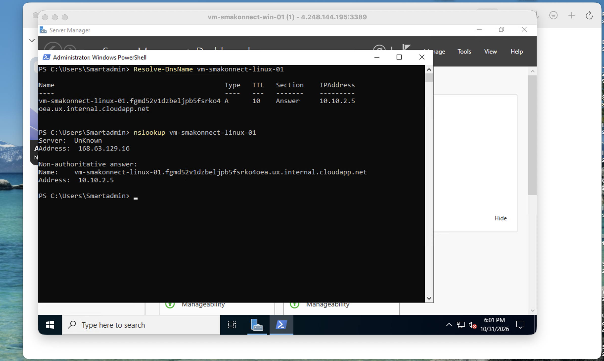
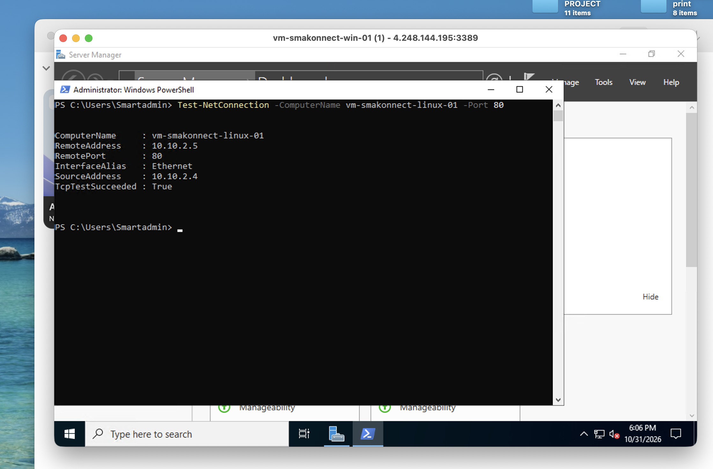
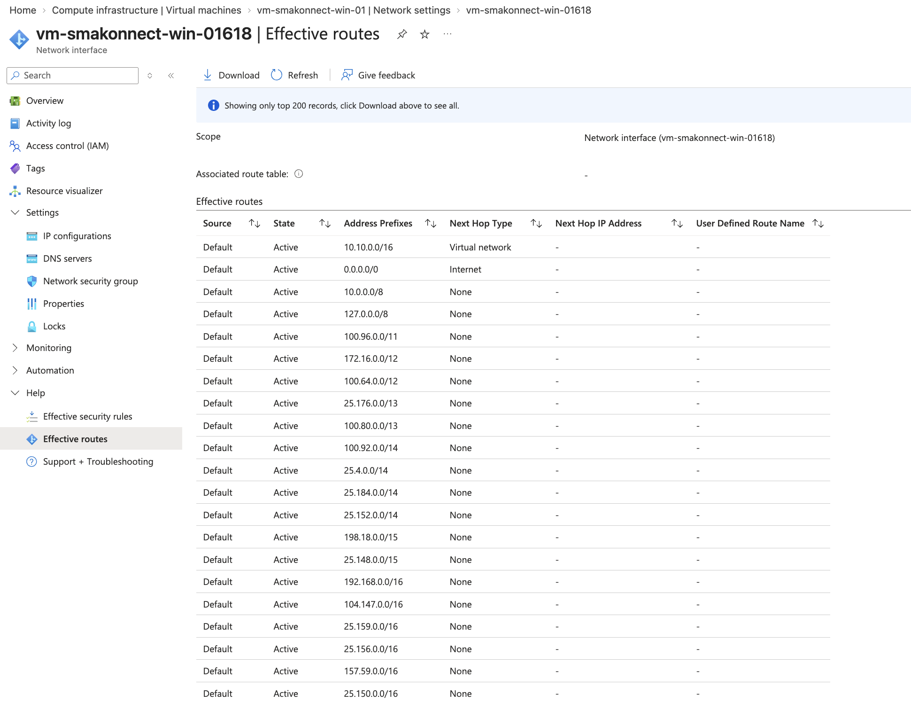
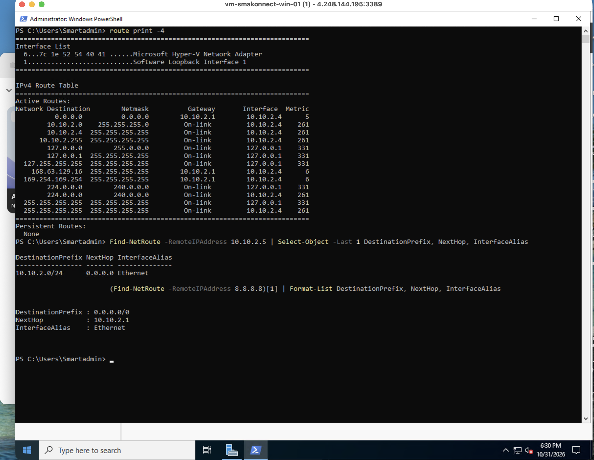
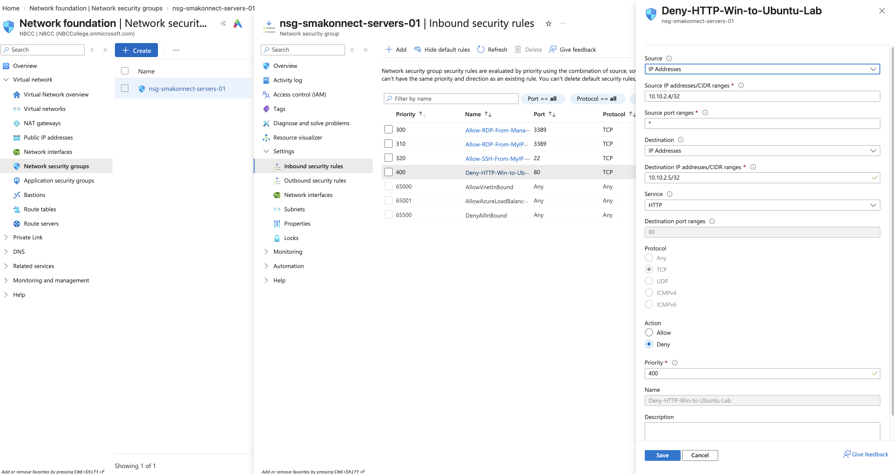
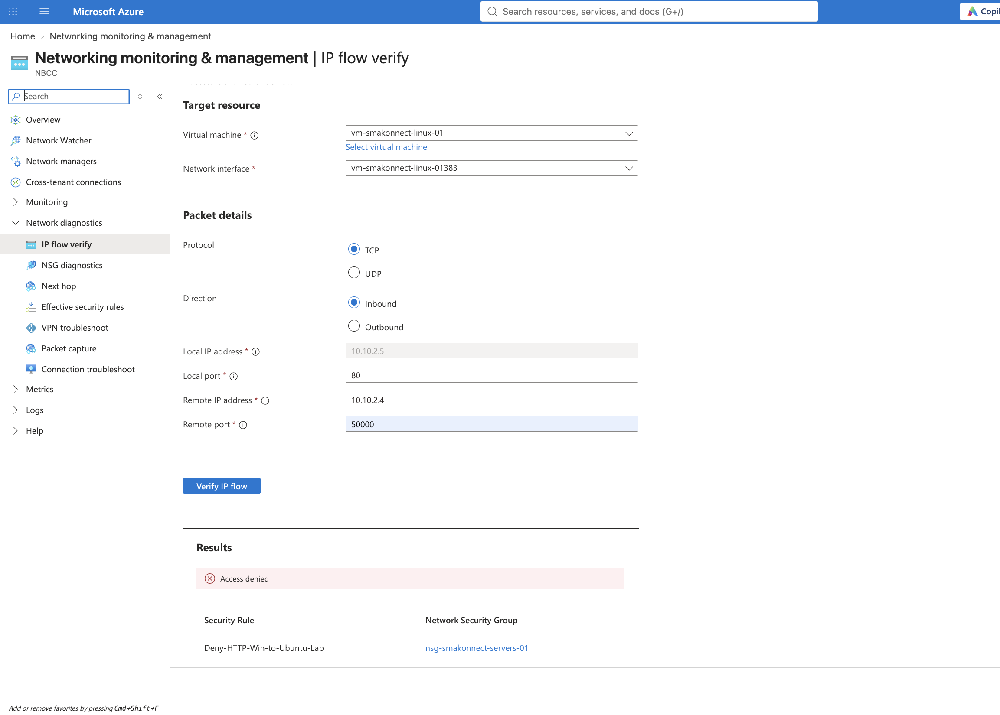
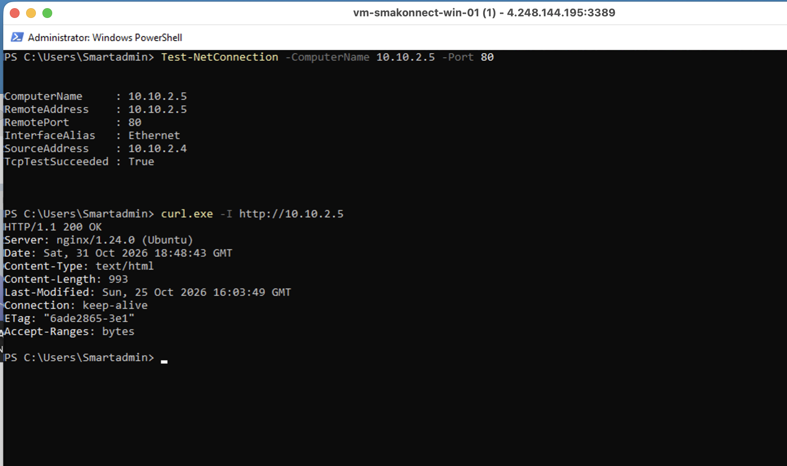
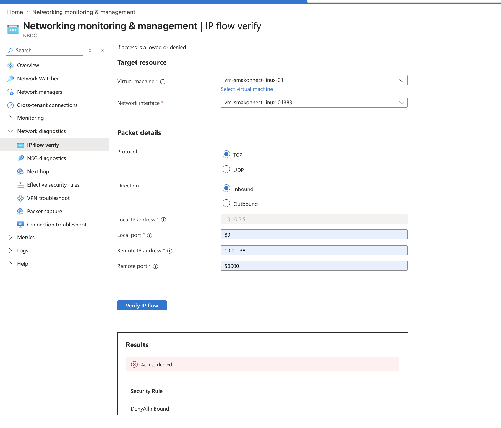
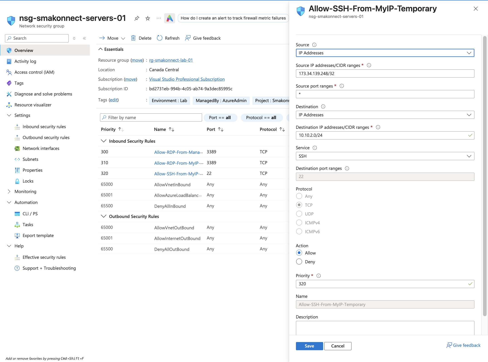

# Phase 07 — Advanced Azure Networking & Troubleshooting

**Project:** Smakonnect Tech Innovation — Azure Infrastructure Administration (AZ-104)  
**Environment:** Microsoft Azure | Canada Central  
**Resource group:** `rg-smakonnect-lab-01`  
**Status:** Completed lab exercises; screenshot evidence captured separately

## Executive summary

This phase focused on diagnosing Azure virtual network connectivity using DNS resolution, effective routes, Windows guest routing, Network Security Groups (NSGs), and Azure Network Watcher. I configured controlled failure scenarios, compared symptoms across tools, identified the relevant configuration, and verified connectivity after remediation.

The environment consists of a Windows Server 2022 VM and an Ubuntu 24.04 VM running an internal Nginx website. Both VMs are connected to the server subnet of the same Azure virtual network. Administrative access is restricted by source-specific NSG rules, while public inbound HTTP is denied.

> **Scope note:** This is a personal lab simulation, not a production outage. I inspected Azure-provided DNS and system routes; I did not deploy custom DNS servers, user-defined routes, Azure Firewall, or a VPN in this phase.

## Learning objectives

- Verify Azure-provided DNS resolution from Windows and Linux.
- Distinguish operating-system hostname resolution from direct DNS queries.
- Interpret Azure effective routes and Windows guest routing tables.
- Troubleshoot an intentionally blocked TCP connection using NSG rules and Network Watcher IP flow verify.
- Confirm service recovery after removing the temporary deny rule.
- Validate that public HTTP is denied while source-restricted administrative SSH remains permitted.

## Lab environment

| Component | Configuration |
|---|---|
| Azure region | Canada Central |
| Resource group | `rg-smakonnect-lab-01` |
| Virtual network | `vnet-smakonnect-lab-01` — `10.10.0.0/16` |
| Server subnet | `snet-servers` — `10.10.2.0/24` |
| Network security group | `nsg-smakonnect-servers-01`, associated with the server subnet |
| Windows VM | `vm-smakonnect-win-01` — `10.10.2.4` |
| Linux VM | `vm-smakonnect-linux-01` — `10.10.2.5` |
| Linux web service | Nginx, HTTP/TCP 80 (internal access) |
| VNet DNS | Azure-provided (default); resolver `168.63.129.16` |

The VNet also includes management (`10.10.1.0/24`), applications (`10.10.3.0/24`), and private-endpoints (`10.10.4.0/24`) subnets. The server subnet is the focus of this phase.

## Lab 1 — Azure DNS and internal hostname resolution

**Task:** Verify that both virtual machines can resolve public DNS names and that the Windows VM can resolve the Ubuntu VM's internal hostname.

**Checks performed:**

Windows PowerShell:

```powershell
ipconfig /all
Resolve-DnsName www.microsoft.com
nslookup www.microsoft.com 168.63.129.16
Resolve-DnsName vm-smakonnect-linux-01
nslookup vm-smakonnect-linux-01
```

Ubuntu:

```bash
resolvectl status
resolvectl query www.microsoft.com
nslookup www.microsoft.com 168.63.129.16
```

**Observed outcome:** Public-name queries succeeded, and Windows resolved `vm-smakonnect-linux-01` to `10.10.2.5`. The internal Nginx website was reachable from Windows using the Ubuntu hostname.



## Lab 2 — DNS troubleshooting: incorrect hosts-file entry

**Scenario:** Simulate a name-resolution failure without changing Azure DNS.

I temporarily added an incorrect Windows hosts-file mapping:

```text
10.10.2.99 vm-smakonnect-linux-01
```

After flushing the local DNS cache, normal Windows hostname resolution selected the incorrect address, and an HTTP connectivity test failed. However, `nslookup` continued to return the correct Azure DNS answer (`10.10.2.5`). This difference helped isolate the issue to local hostname resolution rather than the Azure DNS service.

**Remediation:** Removed the incorrect hosts-file entry, flushed the cache, and retested name resolution and TCP connectivity.

**Observed outcome:** The hostname again resolved to `10.10.2.5`, and `Test-NetConnection` to TCP port 80 succeeded.

```powershell
ping -4 vm-smakonnect-linux-01
Test-NetConnection -ComputerName vm-smakonnect-linux-01 -Port 80
```



> The screenshot shows **post-remediation verification**; it is not presented as evidence of the earlier incorrect hosts-file entry.

## Lab 3 — Azure effective routes and Windows guest routing

**Task:** Inspect how Azure and Windows select routes for destinations inside and outside the VNet.

From the Windows VM's network interface, I inspected **Effective routes** in Azure Portal. Key routes included:

| Address prefix | Next hop type | Interpretation |
|---|---|---|
| `10.10.0.0/16` | Virtual network | Route for Smakonnect VNet destinations |
| `0.0.0.0/0` | Internet | Azure's default system route for other destinations |
| `10.0.0.0/8` | None | Broader system route; overridden by the more-specific VNet route where applicable |

No user-defined route table was associated with the NIC during this exercise.



In Windows PowerShell, I inspected the guest OS routing table:

```powershell
route print -4
Get-NetRoute -AddressFamily IPv4
Find-NetRoute -RemoteIPAddress 10.10.2.5
Find-NetRoute -RemoteIPAddress 8.8.8.8
```

The Windows VM had a default gateway of `10.10.2.1`, while `10.10.2.0/24` was directly connected. Azure platform routes for `168.63.129.16` and `169.254.169.254` were also visible in the guest routing table.



**Additional troubleshooting observation:** `tracert -d 8.8.8.8` showed intermediate timeouts, but separate TCP connectivity tests to external destinations succeeded. I therefore did not treat missing traceroute responses alone as proof of an internet outage.

## Lab 4 — NSG failure simulation and Network Watcher diagnosis

**Scenario:** Simulate an internal application outage by blocking Windows-to-Ubuntu HTTP traffic.

**Baseline:** `Test-NetConnection 10.10.2.5 -Port 80` succeeded before the change.

I created a **temporary** inbound rule on `nsg-smakonnect-servers-01`:

| Rule property | Lab value |
|---|---|
| Name | `Deny-HTTP-Win-to-Ubuntu-Lab` |
| Priority | `400` |
| Source | `10.10.2.4/32` |
| Destination | `10.10.2.5/32` |
| Protocol | TCP |
| Destination port | `80` |
| Action | Deny |

With the rule active, the Windows TCP port 80 test failed. I then used **Azure Network Watcher → IP flow verify** to evaluate inbound TCP traffic to the Ubuntu VM. The result was **Denied**, identifying `Deny-HTTP-Win-to-Ubuntu-Lab` as the matching rule.





**Remediation:** Deleted the temporary deny rule and reran the connectivity test.

```powershell
Test-NetConnection -ComputerName 10.10.2.5 -Port 80
curl.exe -I http://10.10.2.5
```

**Observed outcome:** TCP connectivity was restored. The Ubuntu Nginx service was reachable internally.



> The temporary deny rule was removed after the test; the rule and denial screenshots document the earlier controlled simulation, not the current NSG configuration.

## Lab 5 — Public HTTP exposure check

**Task:** Verify that the Ubuntu VM's public IP does not make its internal website publicly accessible by default.

The Ubuntu VM has a public IP for controlled administration and a private IP (`10.10.2.5`) for VNet communication. A public HTTP connection test from my Mac failed, while internal HTTP access from the Windows VM succeeded.

I also used Network Watcher IP flow verify for an inbound TCP/80 flow from my public IP to `10.10.2.5`. The tool returned **Denied** and identified the default `DenyAllInBound` rule.



**Interpretation:** Network Watcher establishes which NSG rule would apply to the specified flow; the separate client-side HTTP test provided the external connectivity observation. These tests are complementary, not interchangeable.

## Lab 6 — SSH NSG rule hardening

**Task:** Narrow an existing source-restricted SSH rule from protocol `Any` to `TCP`.

The existing inbound rule `Allow-SSH-From-MyIP-Temporary` was updated to use TCP destination port 22. Its source remained restricted to the authorized public IP `/32`, with priority `320` and action **Allow**.

SSH access was tested successfully after the change, and the effective security rule was verified.



**Security note:** The temporary public SSH rule was appropriate for this controlled lab, but production access should be evaluated against organizational requirements, potentially using Azure Bastion, VPN, or other private administrative access patterns.

## Troubleshooting outcomes

| Scenario | Diagnostic approach | Finding | Resolution / verification |
|---|---|---|---|
| Internal hostname resolved incorrectly | Compared Windows hostname resolution with `nslookup` | Incorrect local hosts-file mapping | Removed mapping; verified correct IP and TCP/80 |
| Internal HTTP stopped working | TCP port test, NSG rule inspection, Network Watcher IP flow verify | Temporary priority-400 NSG deny rule | Removed rule; verified TCP/80 and internal web access |
| Traceroute hops timed out | Compared traceroute with TCP connection tests | Missing intermediate responses were inconclusive | Confirmed external TCP connectivity separately |
| Public HTTP was unavailable | External HTTP attempt and IP flow verify | Default inbound NSG deny applied to TCP/80 | Kept public HTTP blocked; verified internal access separately |
| SSH rule permitted all protocols | Inspected NSG rule properties | Protocol scope was broader than required | Restricted to TCP/22; confirmed SSH still worked |

## Skills demonstrated

- Azure Virtual Network DNS and name-resolution troubleshooting
- Windows Server and Ubuntu networking diagnostics
- Azure effective-route and Windows routing-table analysis
- Network Security Group rule evaluation and priority awareness
- Azure Network Watcher IP flow verify
- Controlled fault injection, remediation, and verification
- Source-restricted SSH access and least-privilege network configuration
- Clear technical documentation and screenshot-based evidence

## Evidence index

| # | Screenshot | Demonstrates |
|---|---|---|
| 01 | [Azure DNS resolution](screenshots/01-azure-dns-resolution.png) | Internal hostname resolves to Ubuntu private IP |
| 02 | [DNS troubleshooting](screenshots/02-dns-troubleshooting.png) | Correct name resolution and TCP connectivity after remediation |
| 03 | [Effective routes](screenshots/03-effective-routes.png) | Azure system routes and next-hop types |
| 04 | [Windows routing table](screenshots/04-windows-routing-table.png) | Guest default gateway and directly connected subnet |
| 05 | [NSG deny rule](screenshots/05-nsg-deny-rule.png) | Temporary controlled TCP/80 block |
| 06 | [IP flow denied](screenshots/06-ip-flow-denied.png) | Network Watcher identified the deny rule |
| 07 | [Connectivity restored](screenshots/07-connectivity-restored.png) | Internal HTTP recovery after remediation |
| 08 | [Public HTTP denied](screenshots/08-public-http-denied.png) | Default inbound NSG rule blocked public HTTP |
| 09 | [SSH rule hardening](screenshots/09-ssh-rule-hardening.png) | Source-restricted TCP/22 allow rule |

## Operational and cost considerations

- Avoid leaving unnecessary temporary access rules in place.
- Recheck source IP restrictions if the authorized administrator's public IP changes.
- Deallocate lab VMs when they are not needed to reduce compute charges; review other billable resources separately.
- Never commit passwords, SSH private keys, storage account keys, SAS tokens, or other secrets to GitHub.

## Phase conclusion

This phase strengthened my ability to diagnose connectivity problems across multiple layers: local name resolution, Azure DNS, operating-system routes, Azure effective routes, NSG policy decisions, and application-port reachability. The controlled failures provided practical examples of how to isolate the cause of a networking incident, apply a targeted fix, and verify service restoration without unnecessarily weakening network security.
