# Phase 08 — Azure Monitoring and Diagnostics

**Project:** Smakonnect Tech Innovation | Azure Infrastructure Administration  
**Environment:** Hands-on Azure administration portfolio lab (not production)  
**Region:** Canada Central  
**Resource group:** `rg-smakonnect-lab-01`  
**Phase status:** Completed — Labs 1–7

## 1. Executive Summary

Phase 08 focused on monitoring and diagnosing a simulated organization's Azure infrastructure. The work included performance metrics, centralized log analytics, Windows Event Logs, Linux Syslog, metric-based alerting, administrative Activity Logs, email notifications, and resource/service health investigations.

Rather than relying only on portal configuration, the labs included controlled validation: restarting a Windows service to generate an event, sending a Linux Syslog message, creating CPU load to trigger an alert, and deallocating a VM to verify administrative alerting. The evidence demonstrates the difference between **configuring monitoring** and **proving that monitoring works**.

> **Scope:** All work described here was completed in a learning environment. Service Health showed no active service issues when checked; no platform incident was simulated or claimed. Lab 7 was intentionally limited to two Resource Health screenshots.

## 2. Objectives

- Interpret Azure VM CPU, network, and disk metrics.
- Use Log Analytics and Kusto Query Language (KQL) to investigate telemetry.
- Collect Windows events and Linux Syslog through Azure Monitor Agent (AMA) and Data Collection Rules (DCRs).
- Configure and validate Azure Monitor metric alerts and email notifications.
- Investigate administrative operations through Azure Activity Logs.
- Export subscription Activity Logs to Log Analytics and verify ingestion.
- Distinguish resource-level health from Azure-wide service health.
- Apply cost-conscious monitoring and evidence-based troubleshooting.

## 3. Environment and Resource Inventory

| Component | Resource / configuration | Role |
|---|---|---|
| Azure subscription | Visual Studio Professional | Lab subscription |
| Resource group | `rg-smakonnect-lab-01` | Resource organization |
| Windows VM | `vm-smakonnect-win-01` | Windows performance and event monitoring |
| Ubuntu VM | `vm-smakonnect-linux-01` | Linux Syslog, CPU alert and deallocation tests |
| Log Analytics | `law-smakonnect-monitor-01` | Centralized query and log storage |
| Windows DCR | `dcr-smakonnect-windows-events-01` | Selected Windows System/Application events |
| Linux DCR | `dcr-smakonnect-linux-syslog-01` | Selected Linux Syslog events |
| Action group | `ag-smakonnect-monitor-email-01` | Email notification destination (`SmakAlert`) |
| CPU metric alert | `alert-smakonnect-linux-high-cpu-01` | Ubuntu CPU threshold detection |
| Activity Log alert | `alert-smakonnect-linux-deallocate-01` | Successful Ubuntu deallocation detection |
| Diagnostic setting | `diag-smakonnect-activity-logs-01` | Export subscription Administrative Activity Logs |

**Monitoring cost controls used:** 30-day Log Analytics retention, daily ingestion cap of `0.023 GB/day`, and selective DCR filters. A daily cap is a cost-control mechanism, not an absolute guarantee against every possible monitoring charge.

### Monitoring data flow

```text
Windows VM ── AMA + Windows DCR ──┐
                                  ├── Log Analytics Workspace ── KQL investigation
Ubuntu VM  ── AMA + Syslog DCR ───┤
                                  │
Subscription Activity Log ────────┘
       (Diagnostic Setting: Administrative category)

Ubuntu VM CPU metric ── Metric Alert ──┐
                                      ├── Action Group ── Email notification
VM deallocation event ─ Activity Alert┘
```

---

## 4. Lab 1 — Azure Monitor Metrics

### Objective

Inspect built-in VM metrics and understand how platform telemetry supports performance analysis.

### Activities

1. Opened **Azure Monitor → Metrics** and selected an existing VM as the scope.
2. Inspected **Percentage CPU** using an appropriate aggregation and time range.
3. Explored VM **Network In Total / Network Out Total** metrics.
4. Reviewed available OS disk read/write metrics.
5. Compared how metrics can support investigations of slow response, traffic changes, and disk activity.

### Evidence

**Azure Monitor Metrics overview**  
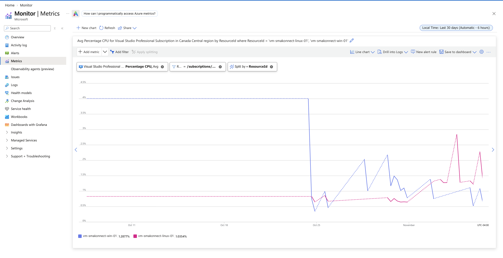

**Windows VM CPU utilization**  
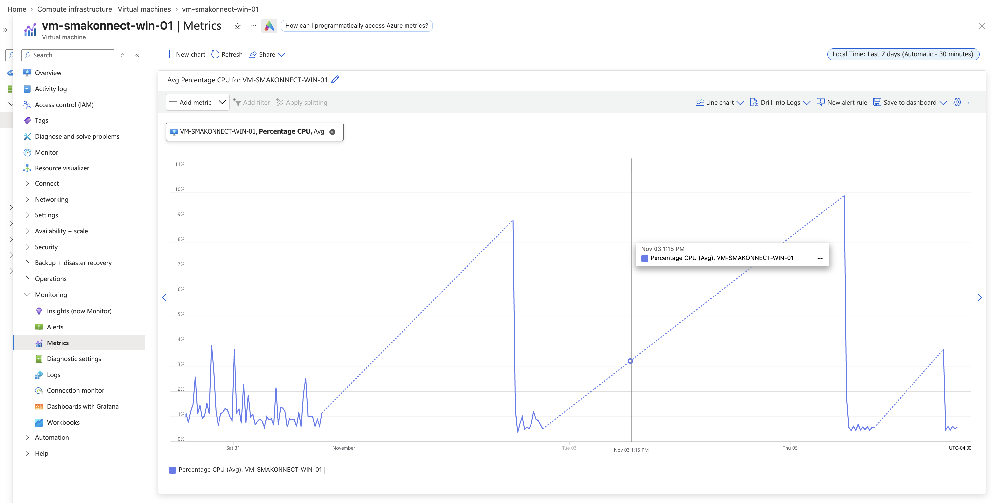

**VM network traffic metrics**  
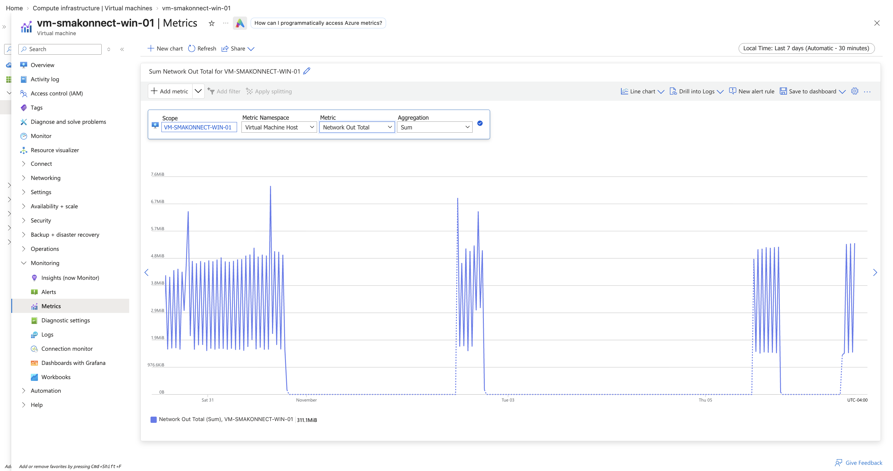

**VM disk performance metrics**  
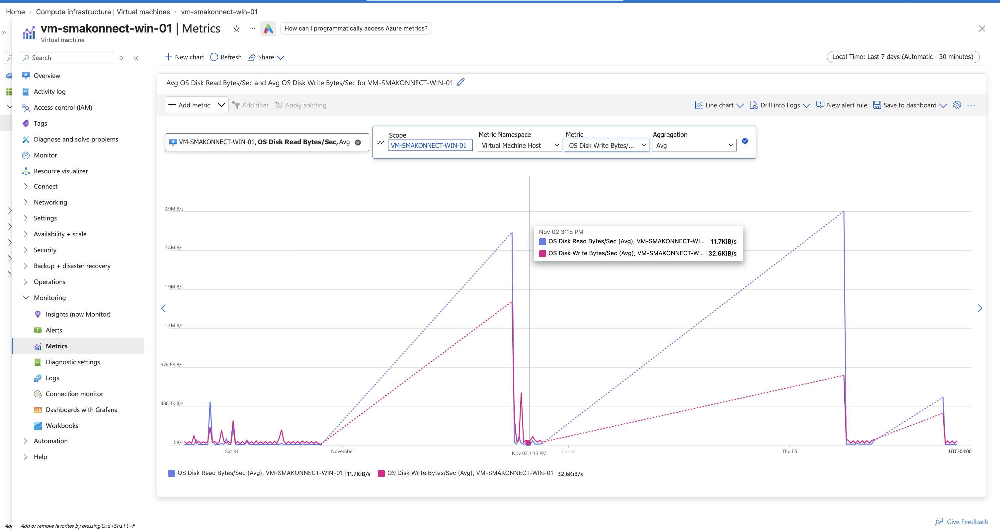

### Outcome

Gained practical experience selecting resource scopes, metric types, aggregations, and time ranges to inspect Azure VM performance.

---

## 5. Lab 2 — Log Analytics and KQL

### Objective

Establish a central workspace for monitoring data and practice querying collected records.

### Configuration

- Workspace: `law-smakonnect-monitor-01`
- Region: Canada Central
- Analytics log retention: **30 days**
- Daily ingestion cap: **0.023 GB/day**

### Example KQL — Inspect recent records

The table queried must contain data; a newly created workspace does not automatically contain all possible telemetry.

```kusto
AzureActivity
| where TimeGenerated > ago(7d)
| project TimeGenerated, OperationNameValue, ActivityStatusValue, ResourceGroup
| order by TimeGenerated desc
| take 20
```

> The `AzureActivity` table was populated later in Lab 6 after the subscription diagnostic setting was configured. Activity Logs are not automatically exported to Log Analytics.

### Evidence

**Log Analytics workspace**  
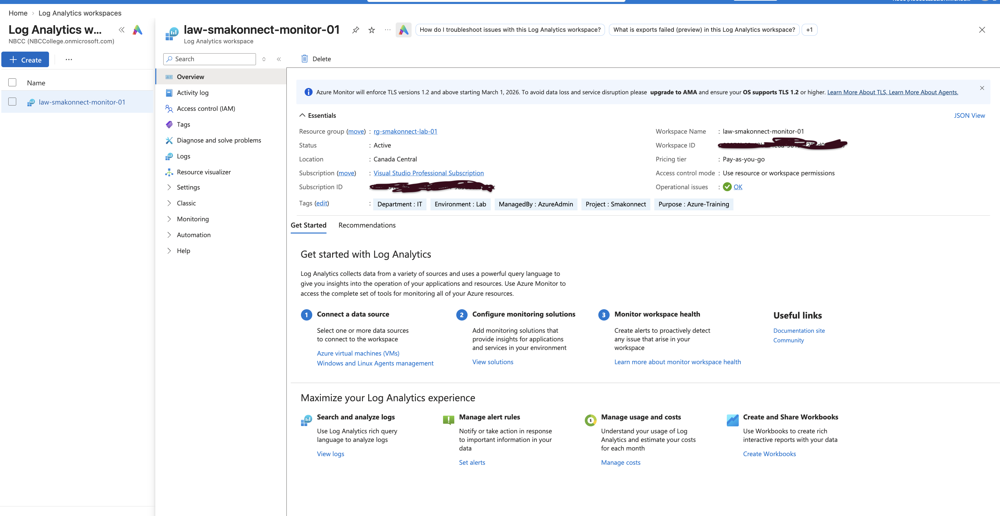

**Workspace retention**  
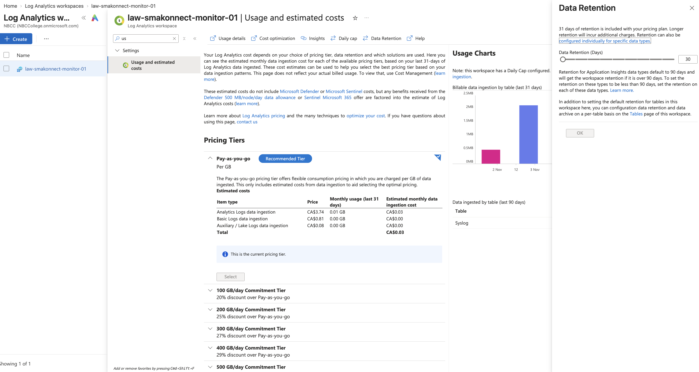

**Workspace daily cap**  
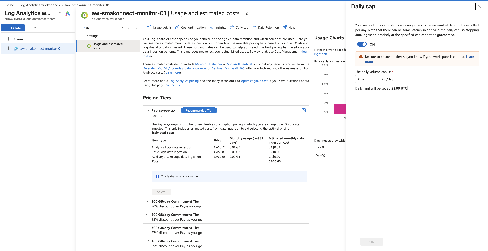

**KQL query results**  
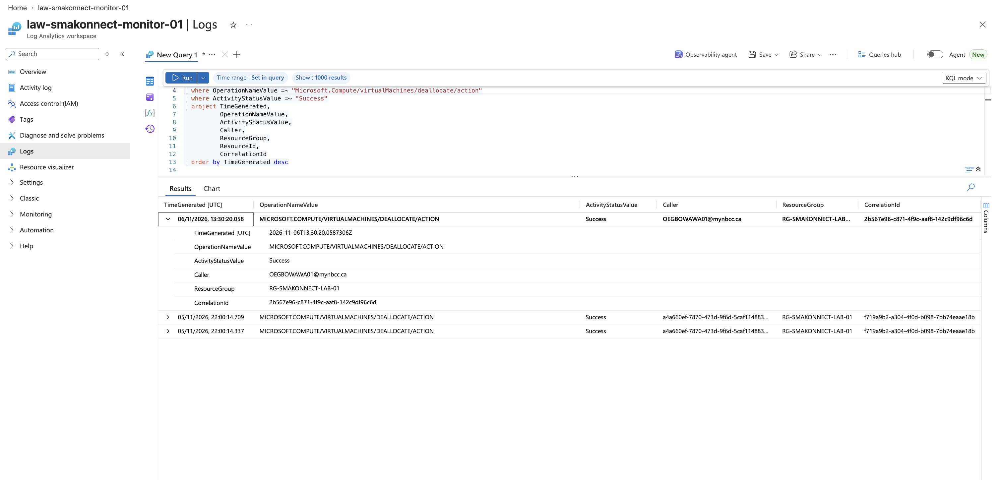

### Outcome

Established the workspace used throughout subsequent labs and practiced reading monitoring data with KQL.

---

## 6. Lab 3 — Windows Event Log Monitoring

### Objective

Collect selected Windows operating-system events centrally and verify the ingestion pipeline with a controlled event.

### Implementation

1. Used **Azure Monitor Agent** on `vm-smakonnect-win-01`.
2. Configured `dcr-smakonnect-windows-events-01`.
3. Associated the DCR with the Windows VM and directed data to `law-smakonnect-monitor-01`.
4. Collected selected **System** and **Application** events.
5. Generated a test event by restarting the Windows **Print Spooler** service.
6. Queried the `Event` table to verify **Event ID 7036**.
7. Restored the DCR to the intended **Critical/Error** filtering after validation; **Security** collection was not enabled.

### Validation query

```kusto
Event
| where EventID == 7036
| project TimeGenerated, Computer, EventLog, EventID,
          Source, RenderedDescription
| order by TimeGenerated desc
```

**Observed result:** A System event with Event ID **7036** was returned, confirming that the Windows event reached Log Analytics. The validation event may not continue to appear after returning the DCR to stricter severity filtering.

### Evidence

**Windows AMA extension**  
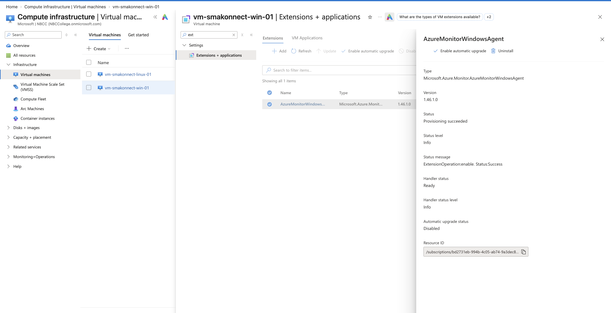

**Windows DCR overview**  
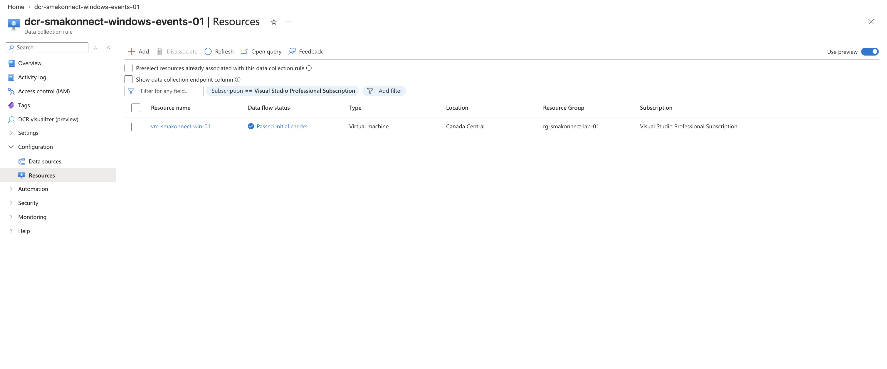

**Windows event source configuration**  
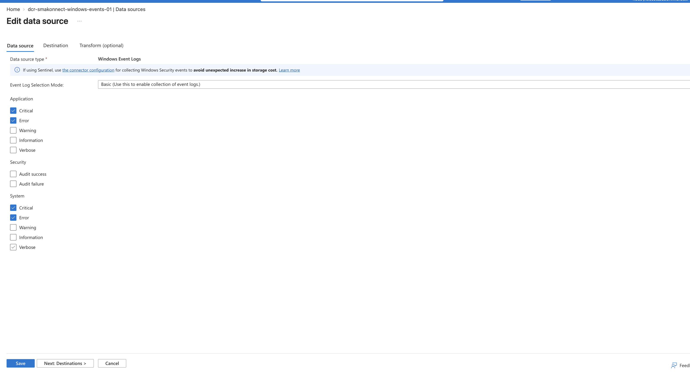

**Windows Event table query**  
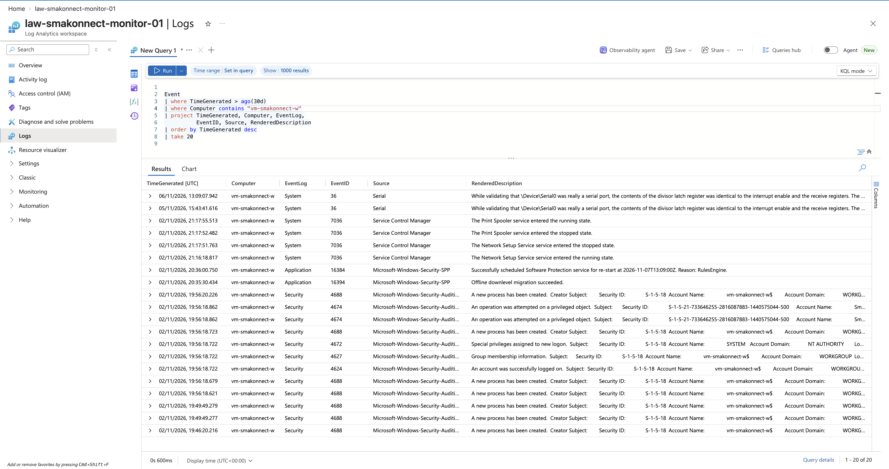

**Print Spooler Event ID 7036 validation**  
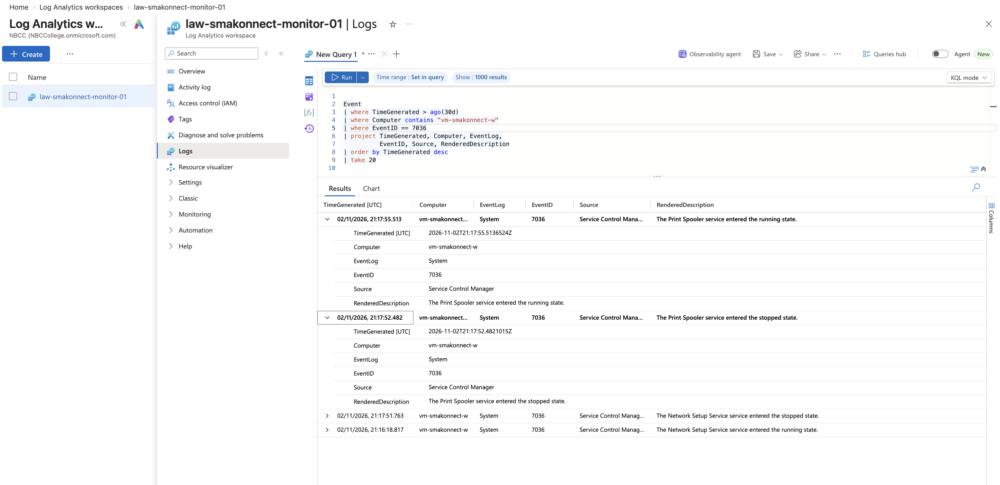

**Windows event ingestion timing**  
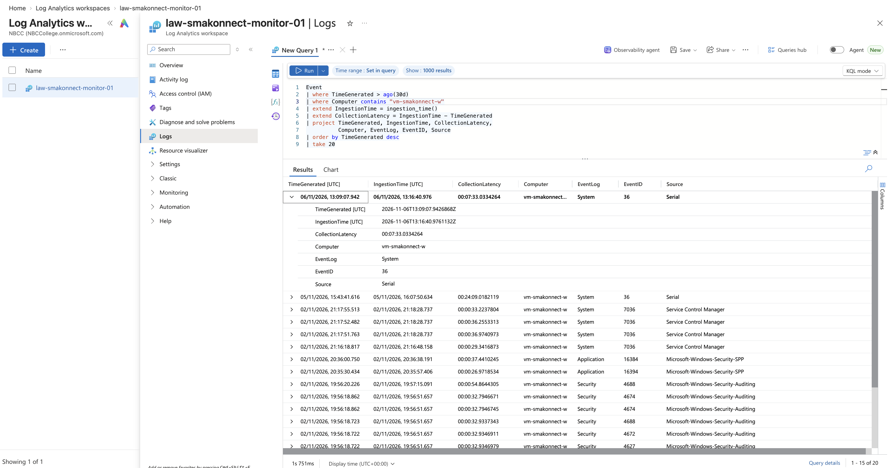

### Outcome

Verified Windows event ingestion end-to-end and learned to balance troubleshooting visibility with ingestion volume.

---

## 7. Lab 4 — Linux Syslog Monitoring

### Objective

Collect Linux system messages centrally and confirm that an intentionally generated Warning-level event is ingested.

### Implementation

1. Used **Azure Monitor Agent** on `vm-smakonnect-linux-01`.
2. Configured `dcr-smakonnect-linux-syslog-01` and associated it with the Ubuntu VM.
3. Selected Syslog facilities **auth**, **authpriv**, **daemon**, and **syslog** at **Warning and above**.
4. Generated a test message from the Ubuntu terminal.
5. Located the test message in the Log Analytics `Syslog` table.

### Test command

```bash
logger -p daemon.warning -t SmakonnectLab \
  "AZURE-MONITOR-TEST: Linux Syslog monitoring verification"
```

### Validation query

```kusto
Syslog
| where SyslogMessage contains "AZURE-MONITOR-TEST"
| project TimeGenerated, Computer, Facility,
          SeverityLevel, SyslogMessage
| order by TimeGenerated desc
```

**Observed result:** The test message appeared in `Syslog`, confirming the Linux DCR and AMA data path.

### Evidence

**Linux AMA extension**  
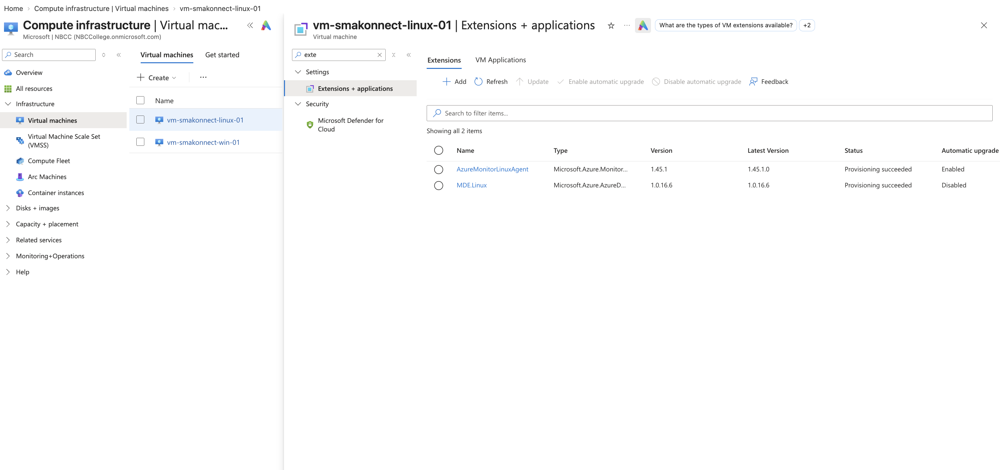

**Linux Syslog DCR**  
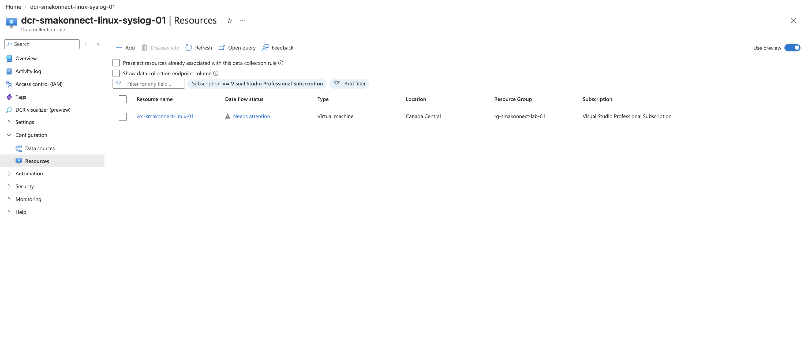

**Syslog facility and severity filters**  
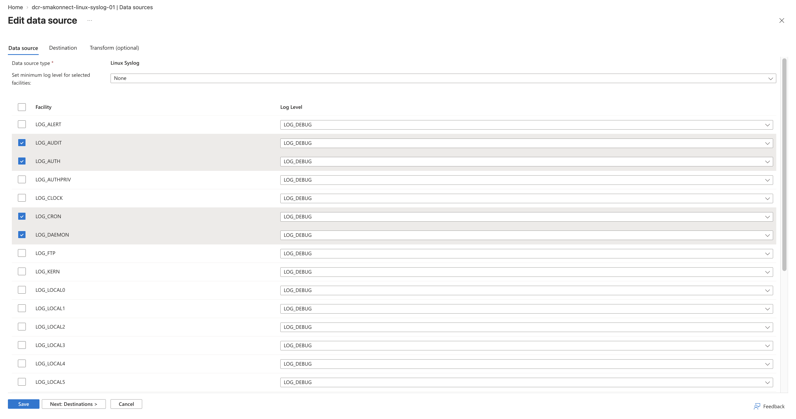

**Terminal test command**  
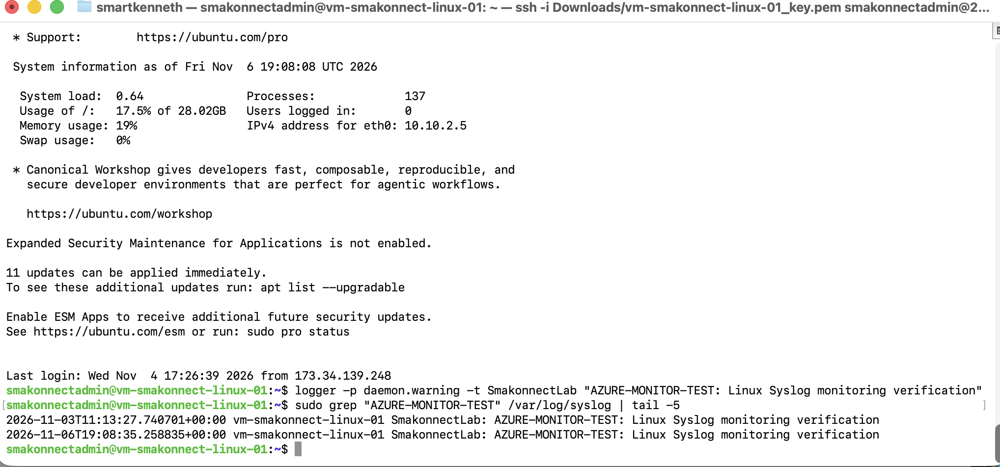

**Syslog query verification**  
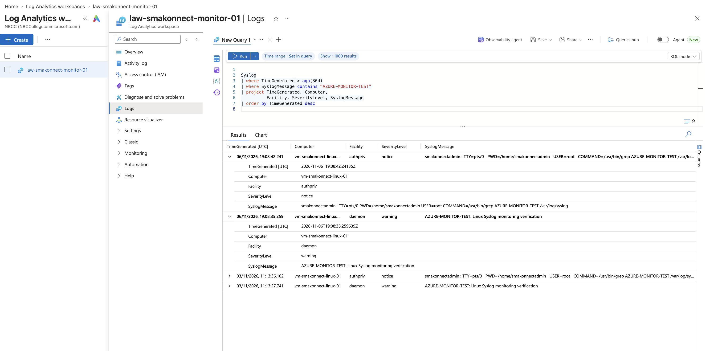

### Outcome

Demonstrated centralized Linux log collection and the use of controlled test messages to validate monitoring configuration.

---

## 8. Lab 5 — CPU Metric Alert and Email Notification

### Objective

Configure a metric alert, deliberately exceed its threshold, and verify delivery of a real notification.

### Alert configuration

| Setting | Value |
|---|---|
| Alert name | `alert-smakonnect-linux-high-cpu-01` |
| Scope | `vm-smakonnect-linux-01` |
| Signal | Percentage CPU |
| Condition | Greater than 20% |
| Aggregation | Average |
| Aggregation period | 5 minutes |
| Evaluation frequency | 5 minutes |
| Severity | 2 |
| Action group | `ag-smakonnect-monitor-email-01` |
| Notification | Email (`Email-Admin`) |

### Controlled validation

Used `stress-ng` on the two-vCPU Ubuntu VM:

```bash
stress-ng --cpu 1 --cpu-load 70 --timeout 8m --metrics-brief
```

The workload increased the observed VM CPU metric above the alert threshold. Azure Monitor fired the alert and the configured Action Group delivered an **actual email notification**. An earlier Action Group test did not deliver as expected; notification settings were checked and delivery was subsequently verified.

**Cost/safety note:** The CPU load was a temporary test. Do not rerun it just to reproduce screenshots.

### Evidence

**Ubuntu CPU metric**  
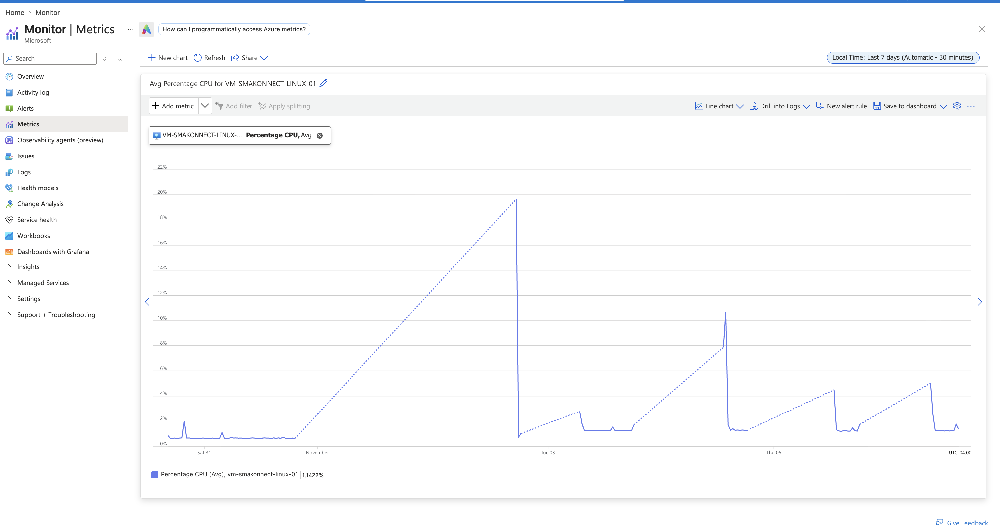

**CPU alert rule**  
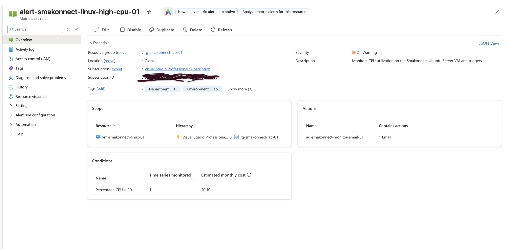

**Email Action Group**  
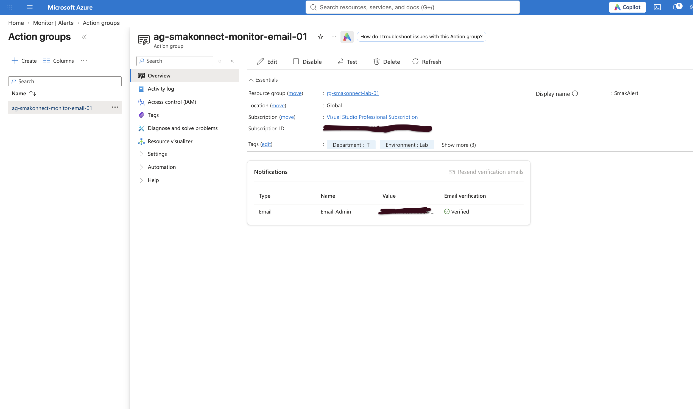

**CPU stress test**  
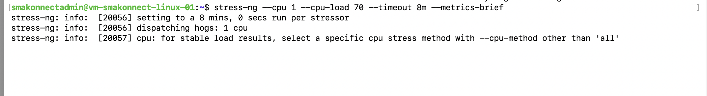

**CPU threshold exceeded**  
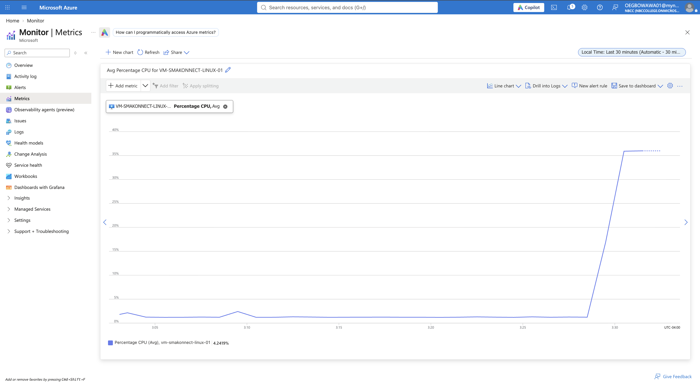

**Fired CPU alert**  
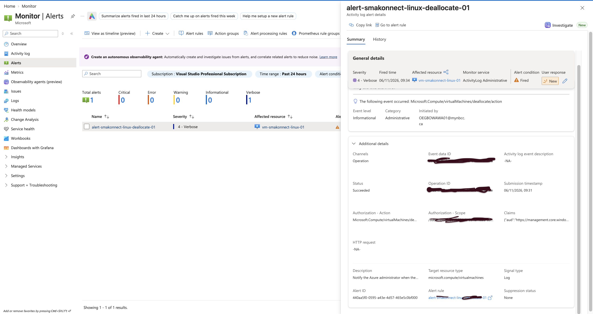

**Received CPU alert email**  
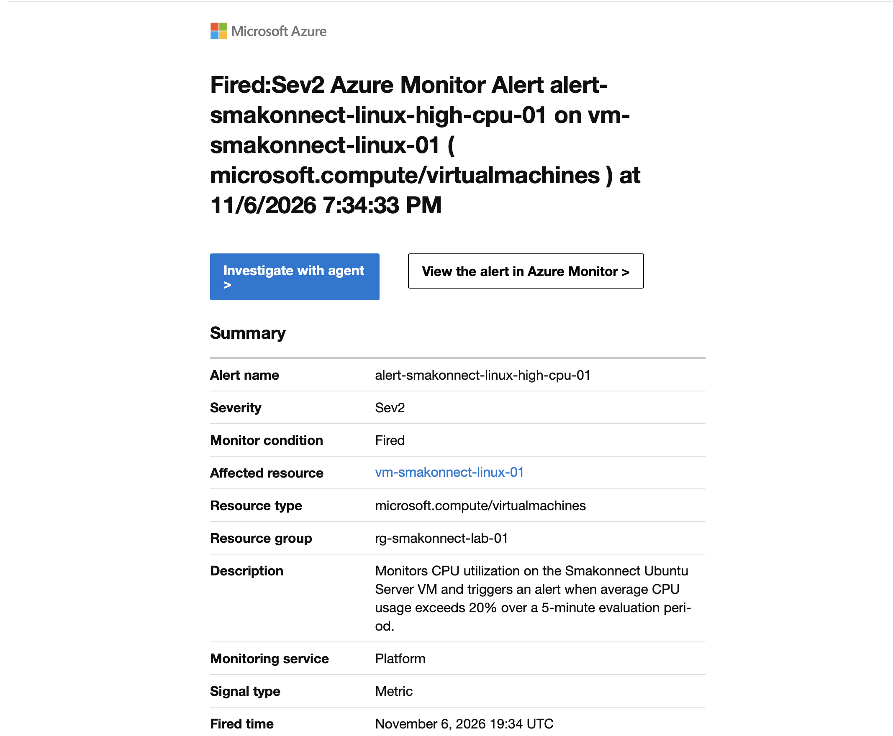

### Outcome

Validated the full workflow from VM performance metric to alert evaluation and email notification.

---

## 9. Lab 6 — Activity Logs and Administrative Monitoring

### Objective

Investigate administrative operations, export subscription Activity Logs to Log Analytics, and verify an alert triggered by a VM deallocation event.

### Part A — Investigating an allocation failure

In Azure Activity Log, inspected a failed start operation for `vm-smakonnect-linux-01`:

- Operation: `Microsoft.Compute/virtualMachines/start/action`
- Result: **Failed**
- Error: **`AllocationFailed`**
- Explanation: Azure reported insufficient capacity for the requested VM size in the selected region.

The VM was later observed running. The specific recovery action for the earlier failure was not conclusively established, so no unsupported remediation is claimed here.

### Part B — Exporting Activity Logs

An initial query against `AzureActivity` returned no rows because subscription Activity Logs had not yet been configured for export to Log Analytics.

Created diagnostic setting **`diag-smakonnect-activity-logs-01`** at subscription scope:

- Category: **Administrative**
- Destination: `law-smakonnect-monitor-01`

After saving the setting and allowing ingestion, administrative operations appeared in `AzureActivity`.

```kusto
AzureActivity
| where TimeGenerated > ago(7d)
| where CategoryValue == "Administrative"
| project TimeGenerated, OperationNameValue,
          ActivityStatusValue, ResourceGroup, ResourceId, Caller
| order by TimeGenerated desc
| take 20
```

> Activity Log export is not retroactive. An older failed start operation may be visible in the portal Activity Log without appearing in the workspace if it occurred before the diagnostic setting was enabled.

### Part C — Deallocation Activity Log alert

Created **`alert-smakonnect-linux-deallocate-01`**:

- Scope: `vm-smakonnect-linux-01`
- Signal: **Deallocate Virtual Machine**
- Category: **Administrative**
- Portal status condition: **Succeeded**
- Severity: **2**
- Action group: `ag-smakonnect-monitor-email-01`

Deallocated the Ubuntu VM through the Azure Portal and confirmed:

1. VM status changed to **Stopped (deallocated)**.
2. The email notification was received.
3. The administrative deallocation operation was recorded in Log Analytics.

### Final KQL validation

```kusto
AzureActivity
| where TimeGenerated > ago(7d)
| where OperationNameValue =~ "Microsoft.Compute/virtualMachines/deallocate/action"
| where ActivityStatusValue =~ "Success"
| where ResourceId contains "vm-smakonnect-linux-01"
| project TimeGenerated, OperationNameValue,
          ActivityStatusValue, Caller, ResourceGroup,
          ResourceId, CorrelationId
| order by TimeGenerated desc
```

**Important troubleshooting distinction:** The Azure Portal labels a successful Activity Log operation **Succeeded**, while the ingested `ActivityStatusValue` was **`Success`**. During investigation, simplifying KQL filters and allowing time for ingestion helped confirm the records. The initial filtered query's lack of results was not proven to be caused solely by the status terminology.

### Evidence

**Activity Log overview**  
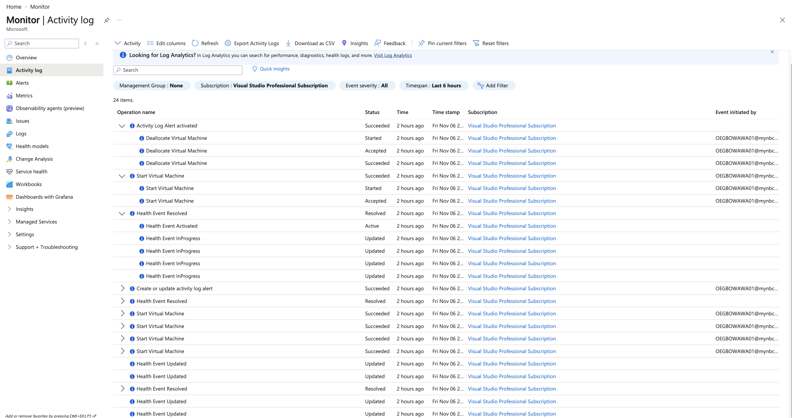

**Allocation failure details**  
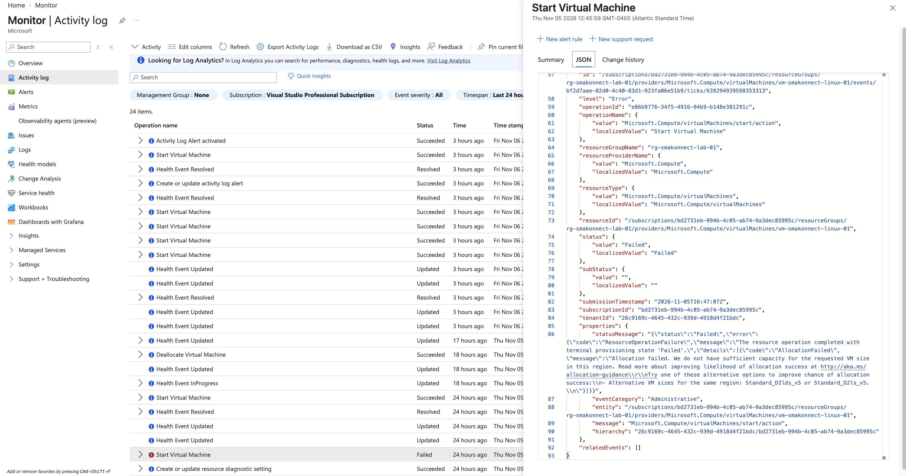

**Subscription diagnostic setting**  
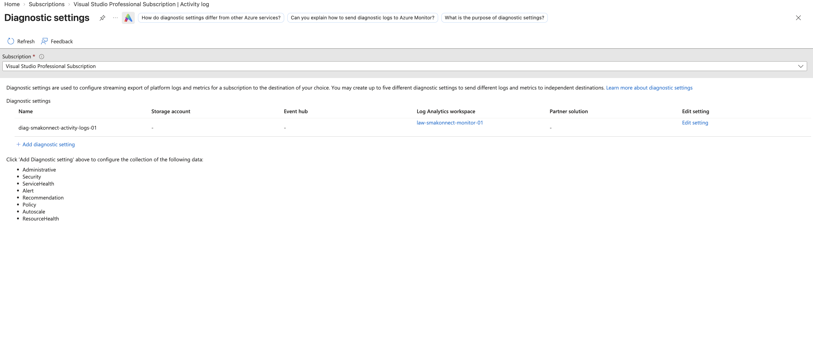

**AzureActivity KQL results**  
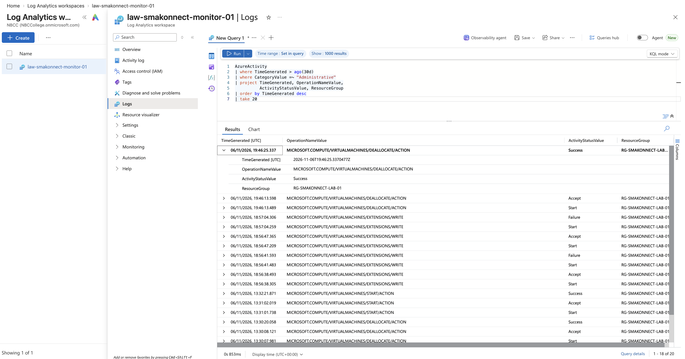

**Deallocation alert configuration**  
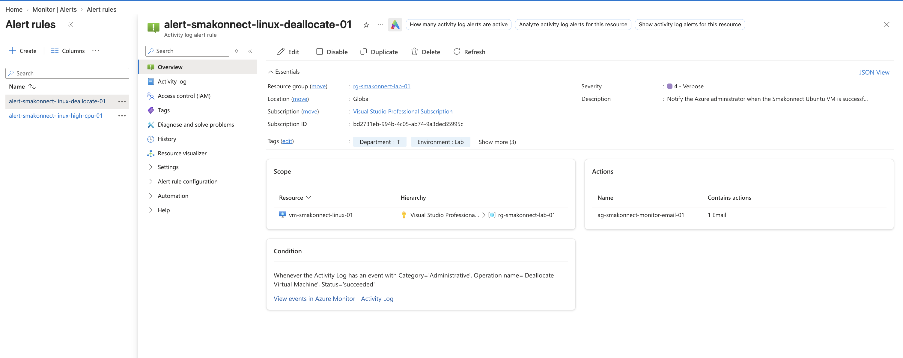

**VM stopped and deallocated**  
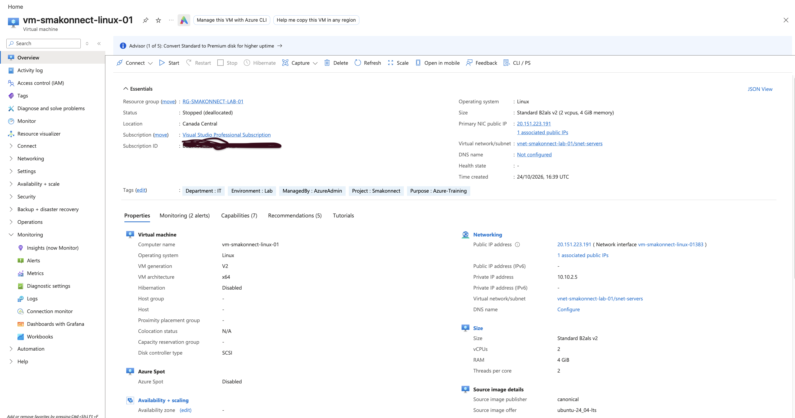

**Received deallocation email**  
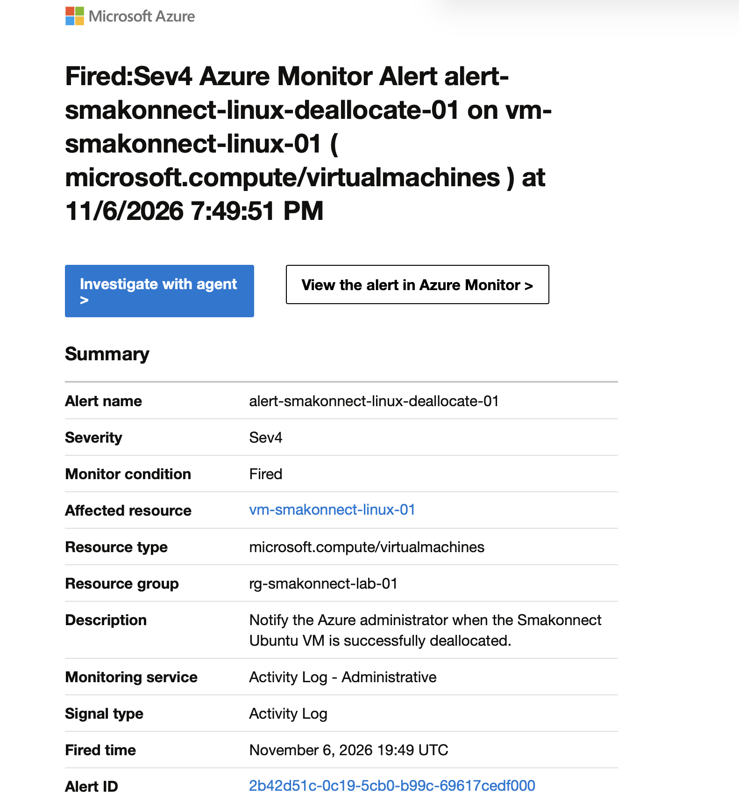

**Deallocation KQL verification**  
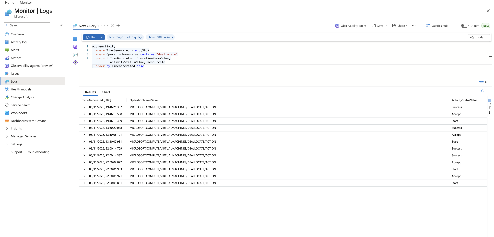

### Outcome

Demonstrated administrative audit investigation, diagnostic export, KQL verification, and a tested Activity Log alert-to-email workflow.

---

## 10. Lab 7 — Azure Resource Health and Service Health

### Objective

Understand the distinction between individual resource availability information and Azure service-level incidents.

### Activities

1. Opened **Resource health** for Ubuntu VM `vm-smakonnect-linux-01`.
2. Opened **Resource health** for Windows VM `vm-smakonnect-win-01`.
3. Opened **Azure Service Health → Service issues** and observed **no active service issues** at the time of inspection.

Resource Health and Service Health provide different perspectives. Resource Health concerns a specific resource's availability; Service Health provides information about incidents and maintenance affecting Azure services and subscriptions. A VM `AllocationFailed` error does not, by itself, establish a regional service outage.

### Evidence — Two screenshots only

**Ubuntu VM Resource Health**  
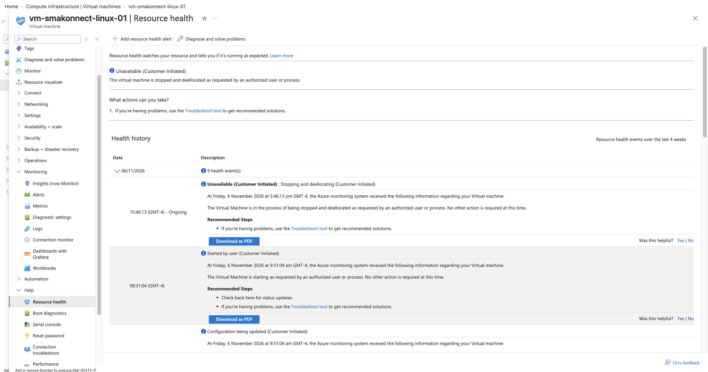

**Windows VM Resource Health**  
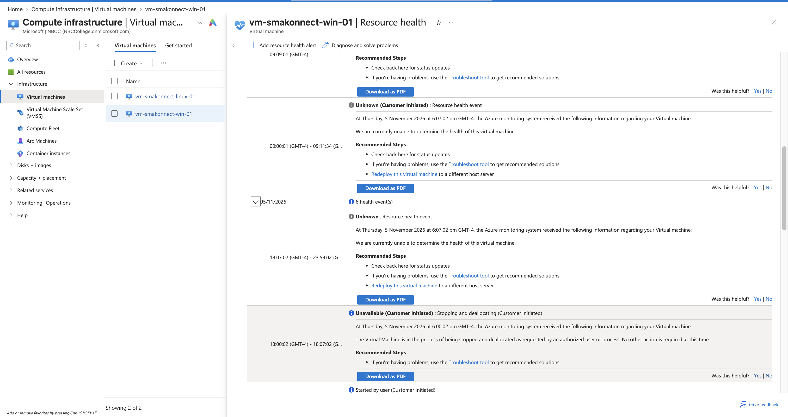

**Note:** No Service Health screenshot is included by design. No Service Health alert rule was created in this lab. The Resource Health availability statuses should be read from the screenshots; they are not assumed in this document.

### Outcome

Completed a basic resource/service health investigation without deploying new resources or generating artificial incidents.

---

## 11. Troubleshooting Register

| Issue or question | Investigation | Verified result / limitation |
|---|---|---|
| Is Windows event collection functioning? | Restarted Print Spooler; queried Event ID 7036 | Event returned in `Event` table |
| Is Linux Syslog collection functioning? | Sent `daemon.warning` test message | Message returned in `Syslog` table |
| Will the CPU alert notify an administrator? | Generated controlled CPU load | Real alert email received |
| Why did a VM start fail? | Inspected Activity Log JSON | `AllocationFailed` capacity error identified; exact recovery action not confirmed |
| Why was `AzureActivity` empty? | Checked subscription diagnostic export | Administrative category export configured; subsequent records appeared |
| Why did a filtered KQL query return nothing? | Simplified query, reviewed actual values and ingestion timing | Deallocation record verified; ingested status `Success` |
| Does deallocation trigger notification? | Deallocated Ubuntu VM | VM state, email and KQL event verified |
| Is there an active Azure service issue? | Inspected Service Health | No active service issues shown at time checked |

## 12. Operational and Cost Considerations

- Restrict log collection to information needed for monitoring and troubleshooting.
- Keep DCR event/facility selections aligned with diagnostic requirements.
- Review workspace ingestion, retention, and costs; the daily cap does not replace cost monitoring.
- Preserve screenshots of successful tests before disabling or deleting temporary alerts.
- Review whether the CPU and deallocation alert rules should remain enabled after testing; their final cleanup state was not independently verified in this document.
- Review the subscription diagnostic setting for ongoing log ingestion costs if Activity Log analysis is no longer required.
- Keep VMs deallocated when they are not needed for hands-on work.
- Redact personal email addresses, subscription/tenant IDs, sensitive JSON claims, and other unnecessary identifiers before publishing evidence.
- For a production environment, consider monitoring ownership, incident escalation, severity, alert noise, retention requirements, and access control.

## 13. Skills Demonstrated

**Monitoring and telemetry:** Azure Monitor Metrics, VM performance analysis, Log Analytics, Azure Monitor Agent, Data Collection Rules.  
**Log analysis:** KQL, Windows Event Logs, Linux Syslog, Azure Activity Logs, ingestion validation.  
**Alerting:** Metric alerts, Activity Log alerts, Action Groups, email notification validation.  
**Troubleshooting:** Capacity-related VM failures, empty query results, control-plane auditing, event filtering, health investigation.  
**Operations:** Evidence collection, cost-conscious configuration, controlled tests, and documentation.

## 14. Evidence Index

All screenshots are stored in [`./screenshots/`](./screenshots/). The evidence is organized by lab prefix:

| Lab | Screenshot prefix | Evidence |
|---|---|---|
| Lab 1 | `lab01-` | Metrics overview, CPU, network, disk |
| Lab 2 | `lab02-` | Workspace, retention, daily cap, KQL |
| Lab 3 | `lab03-` | Windows AMA, DCR, Event ID 7036 |
| Lab 4 | `lab04-` | Linux AMA, Syslog DCR, test message |
| Lab 5 | `lab05-` | CPU alert, Action Group, workload, email |
| Lab 6 | `lab06-` | Activity Logs, allocation failure, diagnostic export, deallocation alert |
| Lab 7 | `lab07-` | Ubuntu and Windows Resource Health (two screenshots only) |

## 15. Conclusion

Phase 08 demonstrated the operational side of Azure administration: collecting telemetry, validating log ingestion, querying evidence, investigating administrative failures, and testing alert delivery. The most valuable results were not simply resource deployments but **verified outcomes**—Windows and Linux events collected, CPU and deallocation alerts delivered by email, and administrative operations retrieved through KQL.

These are transferable foundations for Azure Administrator, Cloud Support, Systems Administrator, and infrastructure troubleshooting roles.

---

**Next phase:** Continue the broader Smakonnect Tech Innovation Azure Infrastructure Administration project according to the project roadmap.
