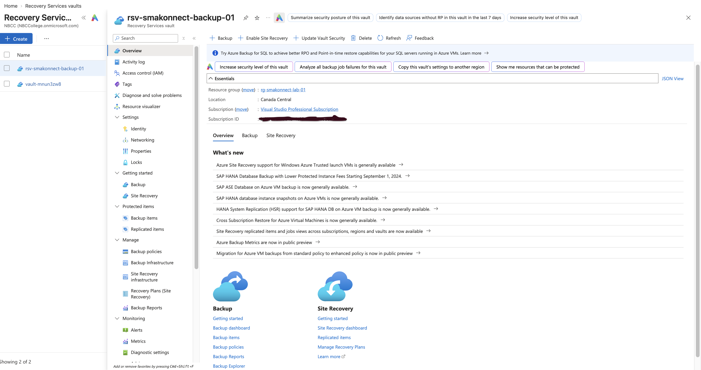
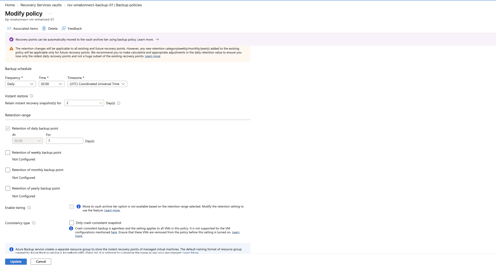
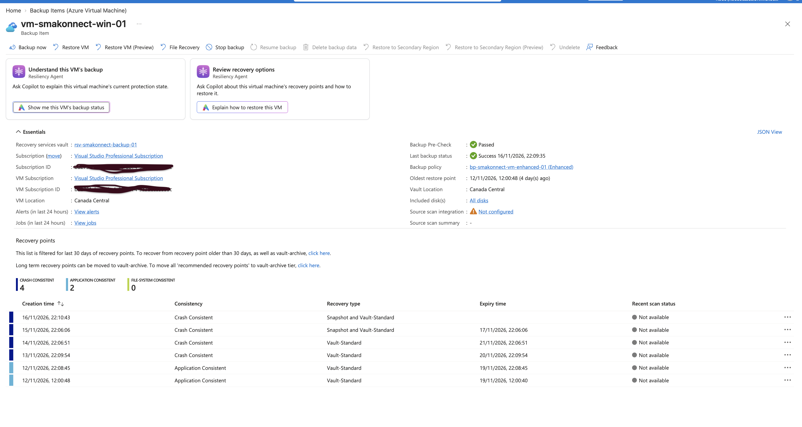
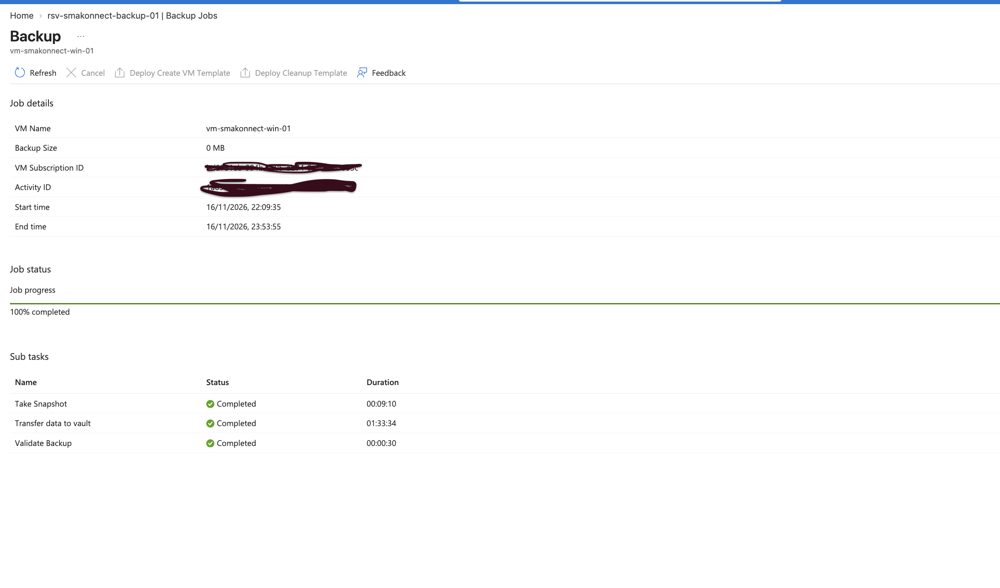
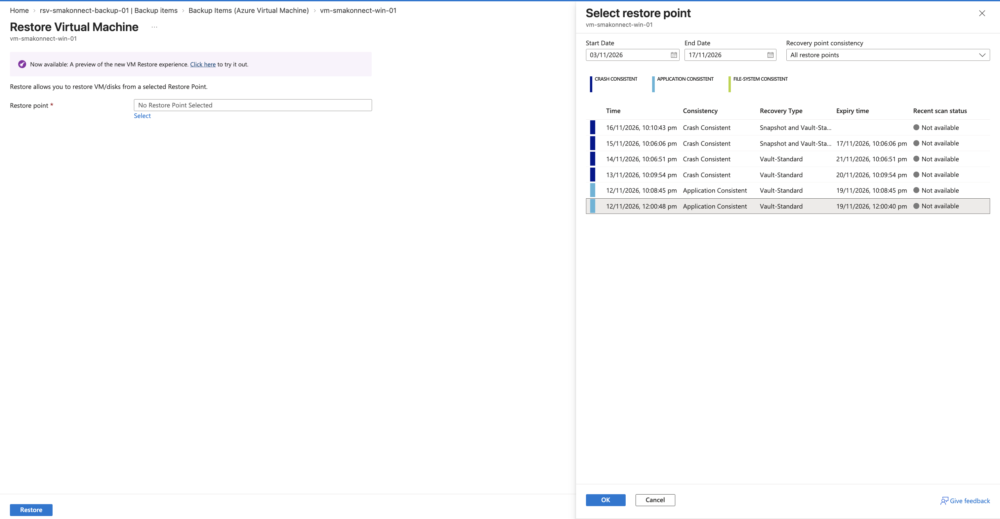
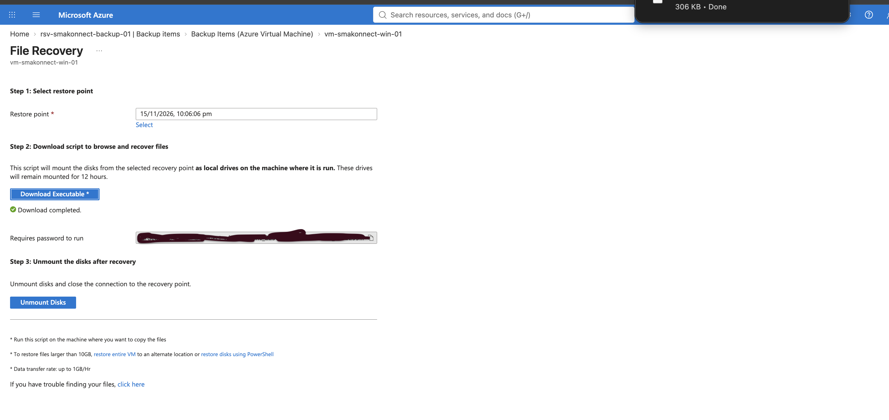
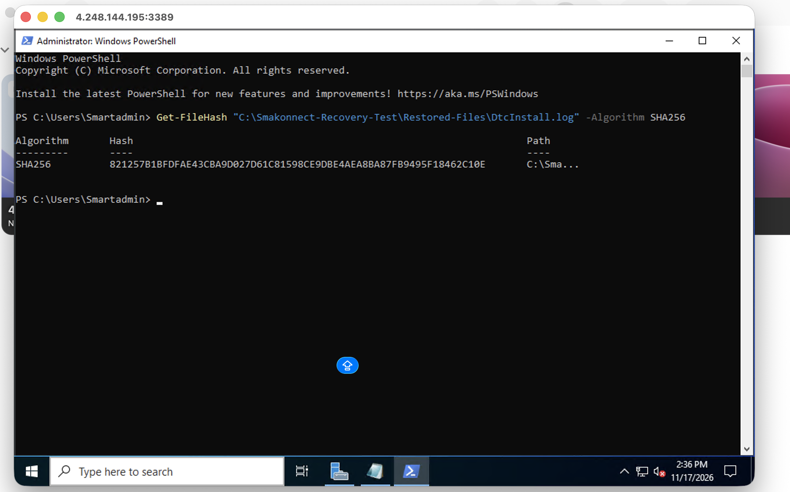
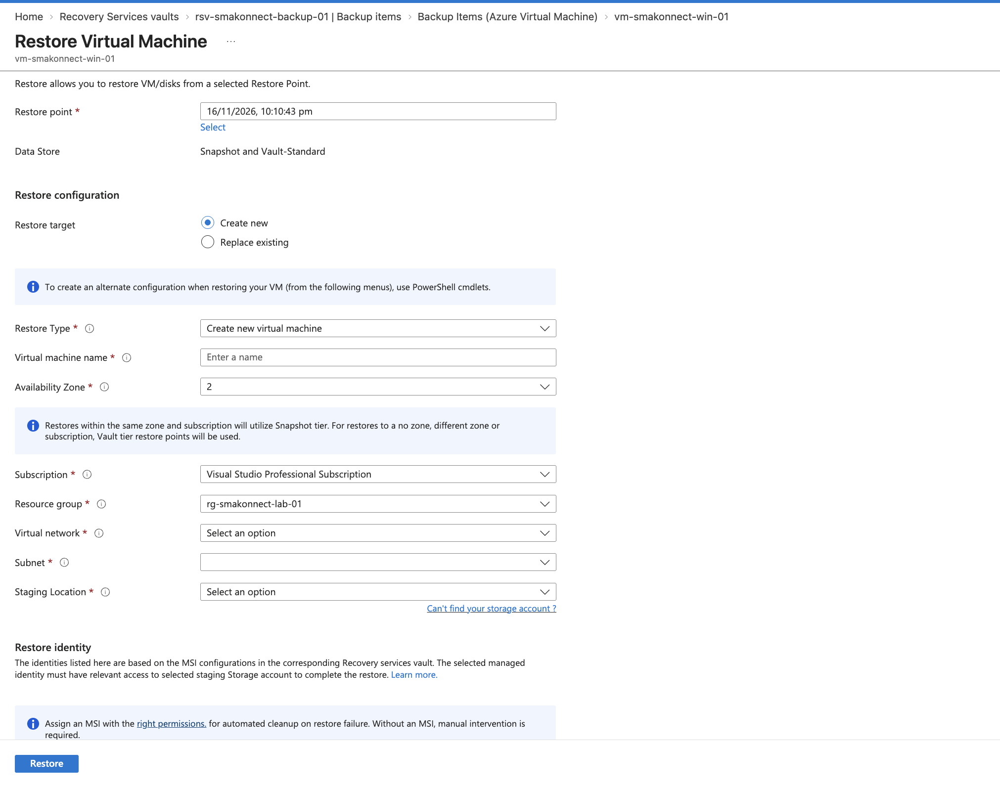
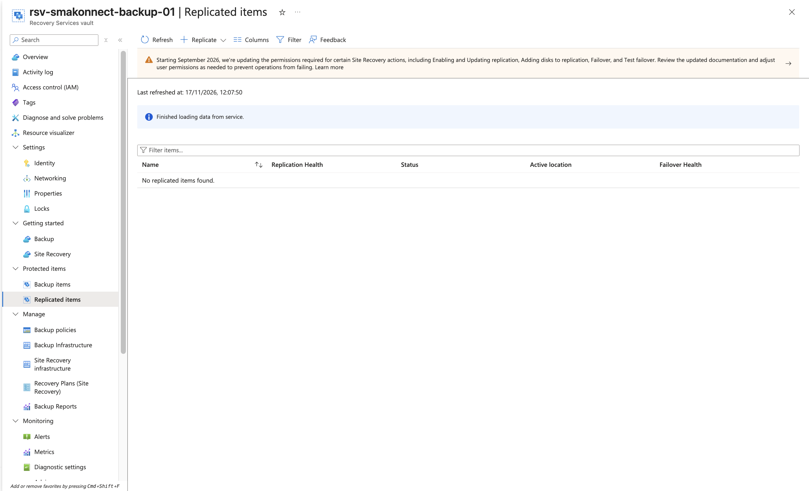
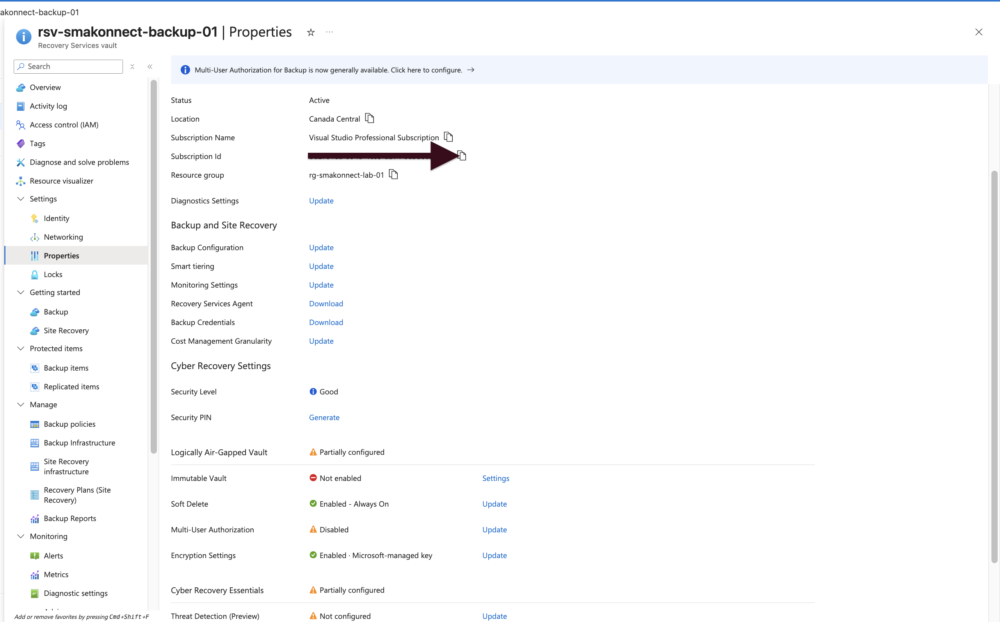

# Phase 09 — Azure Backup and Disaster Recovery

**Project:** Smakonnect Tech Innovation — Azure Infrastructure Administration  
**Environment:** Microsoft Azure | Windows Server 2022  
**Focus:** Backup Configuration, Data Recovery, Business Continuity, and Disaster Recovery

## 1. Introduction

In this phase of the Smakonnect Tech Innovation project, I focused on protecting Azure virtual machines against accidental deletion, data corruption, system failures, and other incidents that could result in data loss.

The goal was not simply to enable Azure Backup. I wanted to understand the entire recovery process, including how backup policies work, where recovery points are stored, how individual files can be recovered, and what options are available when an entire virtual machine becomes unavailable.

I also explored Azure Site Recovery and disaster recovery planning to understand how organizations can maintain business continuity during infrastructure outages.

**Scope of the lab:**

- **Implemented:** Recovery Services vault, enhanced backup policy, VM protection, and backup security configuration.
- **Successfully tested:** Initial VM backup, recovery point creation, file-level recovery, and SHA-256 integrity verification.
- **Explored without executing:** Full VM restore, disk restore, Azure Site Recovery replication, failover, and failback.

## 2. Understanding Azure Backup

Azure Backup is a Microsoft Azure service that helps protect workloads by creating and retaining recoverable copies of their data.

Consider a company running a Windows Server virtual machine that hosts an internal application.

If someone accidentally deletes an important file, or the server experiences a serious operating system failure, the organization needs a way to recover its data.

Azure Backup addresses this requirement by creating recovery points according to a configured backup policy.

### How Azure VM Backup works

1. An administrator creates a Recovery Services vault.
2. A backup policy defines when backups run and how long recovery points are retained.
3. A supported Azure VM is registered for backup protection.
4. Azure Backup coordinates a snapshot of the VM's disks.
5. Backup data is transferred into the vault's backup storage.
6. Recovery points become available for supported restoration operations.

A recovery point represents the backed-up state of the protected workload at a particular time.

For example, if a VM is backed up at 2:00 AM, the recovery point can be used to recover supported data from that backup time.

Changes made after that backup are not automatically included in the earlier recovery point.

## 3. Lab Infrastructure

| Component | Configuration |
|---|---|
| Subscription | Visual Studio Professional |
| Resource group | `rg-smakonnect-lab-01` |
| Region | Canada Central |
| Recovery Services vault | `rsv-smakonnect-backup-01` |
| Windows VM | `vm-smakonnect-win-01` |
| Operating system | Windows Server 2022 |
| OS disk | 127 GiB |
| Backup policy | `bp-smakonnect-vm-enhanced-01` |
| Backup schedule | Daily at 02:00 UTC |
| Vault recovery point retention | 7 days |
| Instant restore retention | 2 days |
| Storage redundancy | LRS |

## 4. Recovery Services Vault

### What is a Recovery Services vault?

A Recovery Services vault is an Azure resource used to manage supported backup and recovery operations.

It provides a central location for backup policies, protected workloads, recovery points, backup jobs, and related security settings.

### Why did I create one?

Before protecting the Windows Server VM, I needed a vault to manage the backup configuration and retained recovery data.

I created:

`rsv-smakonnect-backup-01`

in Canada Central.

### Understanding backup storage redundancy

Azure Backup supports different storage redundancy options, depending on the workload and vault configuration.

**Locally Redundant Storage (LRS):**

Stores redundant copies of backup data within a single datacenter in the selected Azure region.

**Geo-Redundant Storage (GRS):**

Replicates supported backup data to a paired secondary Azure region, providing additional protection against regional disasters.

**Zone-Redundant Storage (ZRS):**

Replicates data across availability zones within a region where supported.

For this lab, I used LRS to keep the backup configuration straightforward and cost-conscious.

**Important:** LRS does not provide cross-region protection.

### Practical implementation

Created the Recovery Services vault and reviewed its storage and security configuration.



## 5. Configuring the Azure VM Backup Policy

### What is a backup policy?

A backup policy defines how frequently Azure Backup protects a workload and how long recovery points are retained.

Without a backup policy, the administrator has not defined the required backup schedule and retention behavior.

### Standard vs Enhanced Backup Policy

Azure VM Backup supports Standard and Enhanced policy types.

A Standard policy provides traditional VM backup scheduling and retention capabilities for supported VM configurations.

An Enhanced policy provides additional backup capabilities, including support for certain newer VM configurations and more flexible scheduling and retention options.

### Practical issue encountered

During this lab, the original Standard backup policy configuration was incompatible with the Windows Server VM's Trusted Launch configuration.

To resolve this, I configured an Enhanced backup policy.

**Policy name:** `bp-smakonnect-vm-enhanced-01`

| Setting | Configured value |
|---|---|
| Policy type | Enhanced |
| Backup frequency | Daily |
| Backup schedule | 02:00 UTC |
| Daily vault retention | 7 days |
| Instant restore retention | 2 days |

### Understanding instant restore retention

Instant restore retention controls how long eligible recovery-point snapshots remain available for faster snapshot-based recovery.

In this lab, I configured two days of instant restore retention.

This means eligible snapshots are retained for that configured period, subject to the backup service's snapshot lifecycle.

Vault recovery points have their own retention settings.

**Important distinction:** Instant restore retention does not mean Azure guarantees that the entire VM will be restored within two days or within any specific number of minutes.



## 6. Protecting the Windows Server Virtual Machine

### Practical implementation

After configuring the backup policy, I enabled backup protection for:

`vm-smakonnect-win-01`

Azure Backup associated the virtual machine with the Recovery Services vault and enhanced backup policy.

### Backup pre-check

Before performing backup operations, Azure evaluates relevant conditions that may affect backup readiness.

The initial backup pre-check passed.

### Initial backup execution

The initial backup completed successfully on November 12, 2026.

The job displayed three successful stages:

**Take Snapshot**

Azure coordinated the capture of the VM's disk state.

**Transfer Data to Vault**

Backup data was transferred to the vault's backup storage.

**Validate Backup**

Azure completed the backup job's validation stage.

The recovery point was reported as application-consistent.

### What does application-consistent mean?

An application-consistent recovery point is created using mechanisms intended to place supported applications and the operating system into a recoverable state.

This can be particularly important for applications that maintain active data or transactions.

Application consistency should not be interpreted as a guarantee that every application will recover successfully without further validation.

### Practical result

- Initial backup job: Completed
- Initial backup pre-check: Passed
- Recovery point: Application Consistent
- Snapshot and vault backup stages: Successful





## 7. Understanding Recovery Points

A recovery point represents a recoverable state captured during a backup.

When restoring a VM or individual file, the administrator selects an appropriate recovery point.

### Example

Assume a file exists at 2:00 AM when a backup runs.

At 10:00 AM, someone accidentally deletes the file.

The administrator can select the 2:00 AM recovery point and recover the file, provided that recovery point remains available.

However, if a file was created at 5:00 AM, it would not exist in the earlier 2:00 AM backup.

This distinction became important during my file recovery testing.

### Practical validation

I opened the VM recovery interface and reviewed the available recovery points, including the application-consistent point created by the initial successful backup.



## 8. Practical File-Level Recovery

This was one of the most important hands-on activities in Phase 9.

Rather than restoring an entire virtual machine, I recovered an individual file from an existing Azure VM backup.

### Why file-level recovery matters

Imagine an employee accidentally deletes a business document from a server.

Restoring the entire server could be unnecessary and disruptive.

File-level recovery allows an administrator to retrieve selected files from an available recovery point without replacing the running VM.

### Steps performed

1. Opened the protected VM in the Recovery Services vault.
2. Selected **File Recovery**.
3. Selected an available recovery point.
4. Downloaded the Azure File Recovery executable.
5. Transferred the executable from macOS to the Windows VM using RDP folder redirection.
6. Ran the recovery executable with administrator privileges.
7. Mounted the backed-up Windows volume as `D:`.
8. Located the required file in the mounted backup.
9. Copied it to the live Windows Server.
10. Verified file integrity and unmounted the recovery disks.

### Understanding the drive letters

During recovery:

- `C:` represented the live Windows Server volume.
- `D:` represented the mounted backed-up volume.

These drive letters describe this particular recovery session and are not fixed for every Azure File Recovery operation.

### Recovered file

**Source:**

`D:\Windows\DtcInstall.log`

**Destination:**

`C:\Smakonnect-Recovery-Test\Restored-Files\DtcInstall.log`

**File size:** 4,436 bytes

The recovery operation successfully copied the file from the backup volume to the running VM.



## 9. Validating File Integrity with SHA-256

Recovering a file is only one part of a recovery test.

I also wanted to verify that the recovered file matched the backed-up source.

### What is SHA-256?

SHA-256 is a cryptographic hash algorithm that produces a fixed-length digest from file contents.

If two files produce the same SHA-256 hash, this provides strong evidence that their contents are identical.

### PowerShell commands

While the backup volume was mounted, I calculated the hashes of the backed-up source and recovered destination.

```powershell
Get-FileHash "D:\Windows\DtcInstall.log" -Algorithm SHA256

Get-FileHash "C:\Smakonnect-Recovery-Test\Restored-Files\DtcInstall.log" -Algorithm SHA256
```

Both files produced:

```text
821257B1BFDFAE43CBA9D027D61C81598CE9DBE4AEA8BA87FB9495F18462C10E
```

### Result

The SHA-256 values matched.

This confirmed that the file recovered from Azure Backup had the same contents as the backed-up source file.

After validation, I safely unmounted the recovery disks.



## 10. Understanding Full VM Restore and Disk Restore

**Status: Portal exploration only — no full VM or disk restore executed.**

Azure Backup provides recovery options beyond individual file recovery.

### Option 1: Create a new virtual machine

This option uses a selected recovery point to restore a VM as a separate Azure resource.

It can be useful when the original VM is unavailable or when an administrator needs to test a recovered workload in an isolated environment.

Depending on the restore configuration, administrators must consider resource names, networking, permissions, and related infrastructure.

### Option 2: Restore disks

This option restores backed-up disks without immediately creating a new running VM.

An administrator can then use those disks in an appropriate recovery or reconstruction workflow.

This can provide more control over how the recovered infrastructure is assembled.

### Option 3: Replace existing

This option supports restoring backed-up VM disks to the existing VM through Azure Backup's supported replacement workflow.

It should be approached carefully because replacing VM disks can affect the current state of the workload.

### Why I did not execute a full VM restore

I reviewed the available restore targets, recovery point selection, and staging storage requirements.

However, I did not initiate a full VM or disk restore because the additional recovery resources could introduce costs.

The successful file-level recovery provided practical validation of recovering data from an Azure VM backup, but it does not replace a complete VM disaster recovery test.



## 11. Understanding Azure Site Recovery

**Status: Architecture and portal exploration only — replication not enabled.**

### What is Azure Site Recovery?

Azure Site Recovery is a disaster recovery service designed to replicate supported workloads to another location and coordinate recovery during outages.

Azure Backup and Azure Site Recovery address related but different recovery needs.

| Azure Backup | Azure Site Recovery |
|---|---|
| Creates recoverable backup data | Replicates supported workloads |
| Useful for file, disk, and VM recovery | Useful for workload failover |
| Uses backup policies and recovery points | Uses replication and recovery configurations |
| Focuses on recoverability and retention | Focuses on continuity and disaster recovery |

Azure Site Recovery is not a replacement for a comprehensive backup strategy.

### What is replication?

Replication is the process of maintaining a recoverable copy of a workload's state at another supported location.

For example, a business running a VM in Canada Central may configure supported replication to Canada East.

If a qualifying outage affects the primary environment, the organization may initiate a failover to the recovery environment.

### What is failover?

Failover is the process of switching a workload from its primary environment to a recovery environment.

### What is test failover?

Test failover allows administrators to validate supported recovery procedures without performing an actual production failover.

It is an important part of disaster recovery planning because an untested recovery process may not behave as expected during an incident.

### What is failback?

Failback is the process of returning workloads to their intended primary environment after recovery conditions are met.

The exact procedure depends on the supported replication scenario.

### What are Recovery Plans?

Recovery Plans help organize and coordinate recovery actions for protected workloads.

For example, an application may depend on a database server.

A recovery plan can help coordinate the required recovery sequence and supported automation.

### What I explored in Azure

I reviewed the Site Recovery configuration workflow, replicated items, and Recovery Plans.

During the exploration, I encountered a regional validation issue because the selected vault was in Canada Central, the same region as the source VM.

This helped demonstrate why cross-region disaster recovery requires appropriate source and target configuration.

I considered a separate Recovery Services vault in Canada East but did not deploy it.

**Final lab state:**

- Replicated items: 0
- Cross-region replication: Not enabled
- Test failover: Not performed
- Failback: Not performed



## 12. Backup Security and Soft Delete

### What is soft delete?

Soft delete provides an additional safeguard against accidental or malicious deletion of supported backup data.

Instead of immediately removing protected backup information in supported deletion scenarios, Azure retains it according to the applicable soft-delete configuration.

This can provide administrators with an opportunity to recover data after a deletion event.

### Practical configuration

I reviewed the Recovery Services vault's security settings and confirmed that soft delete was configured as **Always On**.

The exact soft-delete retention period was not separately recorded during the lab.

### Why this matters

Backup protection should not depend only on successfully creating recovery points.

Administrators also need to consider what happens if backup data is deleted or protection settings are changed.



## 13. Understanding RPO and RTO

Two important concepts in disaster recovery planning are Recovery Point Objective and Recovery Time Objective.

### Recovery Point Objective (RPO)

RPO represents the maximum acceptable amount of data loss, measured in time.

**Example:**

- Last successful backup: 2:00 PM
- Server failure: 4:00 PM
- Potential data loss: 2 hours

If the organization requires an RPO of 30 minutes, this backup interval would not be sufficient to guarantee that objective.

### Recovery Time Objective (RTO)

RTO represents the target amount of time an organization can tolerate before restoring a service following an interruption.

For example, an organization might define:

- RPO: 30 minutes
- RTO: 2 hours

This means the organization aims to lose no more than 30 minutes of data and restore the affected service within two hours.

### Important distinction

RPO measures acceptable data loss.

RTO measures acceptable recovery time.

Both are business requirements that must be supported by appropriate technology, operational procedures, and testing.

## 14. Troubleshooting and Lessons Learned

### Issue 1: Standard backup policy compatibility

**Problem:** The original policy configuration was incompatible with the Windows VM's Trusted Launch configuration.

**Resolution:** Configured an Enhanced backup policy.

**Lesson:** Backup policy compatibility must be checked against VM features and supported configurations.

### Issue 2: Recovery executable downloaded on macOS

**Problem:** The Azure File Recovery executable needed to run in the Windows recovery environment.

**Resolution:** Transferred it to the Windows VM using RDP folder redirection and executed it with administrator privileges.

**Lesson:** Recovery utilities may have operating system requirements that differ from the administrator's local workstation.

### Issue 3: Expected test file missing from backup

**Observation:** A file created after the selected backup recovery point was not present on the mounted backup volume.

**Lesson:** A recovery point only represents the workload's backed-up state at the relevant time.

### Issue 4: Site Recovery region validation

**Problem:** The explored cross-region replication configuration used a vault in the source VM's region.

**Lesson:** Disaster recovery planning requires understanding region placement, recovery resources, and supported replication architecture.

## 15. Final Results

### Successfully implemented and validated

- Recovery Services vault deployment
- Enhanced Azure VM backup policy
- Windows Server VM backup protection
- Successful initial backup job
- Application-consistent recovery point
- File-level recovery from a mounted backup volume
- SHA-256 integrity verification
- Vault soft-delete security review

### Explored and understood

- Full VM restoration
- Managed disk restoration
- Replace-existing VM recovery
- Azure Site Recovery replication
- Failover and test failover
- Failback and Recovery Plans
- Cross-region disaster recovery architecture
- Recovery Point Objective and Recovery Time Objective
- Backup redundancy and retention considerations

## 16. Conclusion

Phase 9 strengthened my understanding of how Azure administrators protect virtual machines and recover data following failures or accidental deletion.

The most significant hands-on result was successfully restoring a file from an Azure VM recovery point and verifying its integrity using SHA-256.

I also gained a clearer understanding of the differences between backup, restoration, replication, and disaster recovery.

While full VM restoration and Site Recovery failover were not executed, exploring their configurations helped me understand the requirements and operational considerations involved in planning a more complete recovery strategy.

This phase forms part of my ongoing Smakonnect Tech Innovation Azure infrastructure administration portfolio project.
